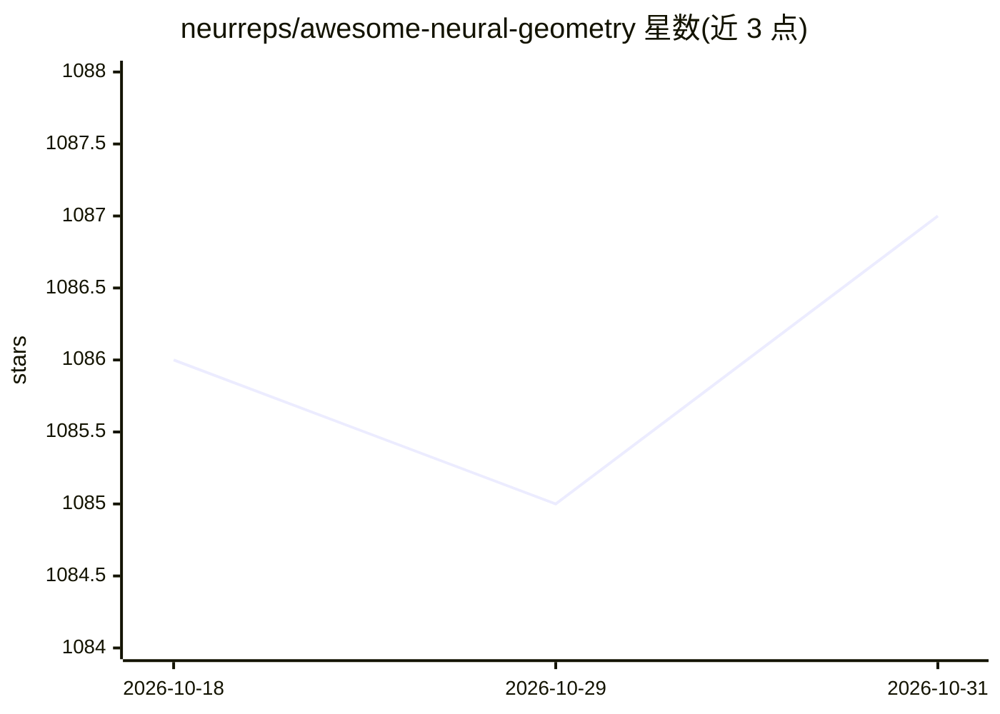

# neurreps/awesome-neural-geometry

⭐ 1,087 · 推送 2026-02-24 · [GitHub](https://github.com/neurreps/awesome-neural-geometry) · [官网](https://neurreps.org) · 组织维护

**神经表示几何研究的资源与文献策展清单**

围绕大脑、深度网络中表示的几何结构而组织的教学资源与研究文献清单，由 Symmetry and Geometry in Neural Representations Slack 工作区协作生成，以 PR 方式持续补充。内容按抽象代数与群论、微分几何与李群、信息几何、动力学、拓扑、几何机器学习、计算神经科学等主题分类，收录教科书、课程、博客、数据集、软件库与研讨会列表。清单自述为进行中的协作工作，无安装或运行方式。

## 筛选速览

| 维度 | 判定 | 备注 |
|---|---|---|
| AI 角色 | `ai-knowledge` | 知识聚合/清单类 |
| 许可风险 | `none` | — |
| 部署形态 | `None` |  |
| 模型依赖 | — | README 未给出锁定关系 |
| 硬件要求 | — | 无带数字的原话,不猜 |
| 安装摩擦 | `low` | 无编译、无系统依赖或容器化 |
| 成熟度 | `idea` | |

## 能力要点

- 覆盖群论、微分几何、拓扑、几何深度学习等多主题的教学资源与文献
- 收录 OpenNeuro、Allen Brain Atlas 等神经科学数据集条目
- 收录 Geomstats、E3NN、Giotto TDA 等几何机器学习软件库条目
- 列出 2022–2023 年对称与几何相关研讨会

## 适用场景

- 查找几何深度学习与等变神经网络的入门教材和课程
- 按主题检索神经表示几何方向的论文与综述
- 寻找流形计算、拓扑数据分析相关软件库与数据集

## 场景标签

`精选清单` · 领域:学习与行业

## 证据(README 行号)

> L1: # Awesome Neural Geometry
> L5: A curated collection of resources and research related to the geometry of representations in the brain, deep network

## 星数曲线

2026-10-18 1,086 → 2026-10-31 1,087（+1）

---
*卡片 v1 · prompt 1.4 · 生成 2026-10-21 · 置信度 high · 依据 README sha `4ee13be6c97e` · [字段定义](../../DATASET.md)*
