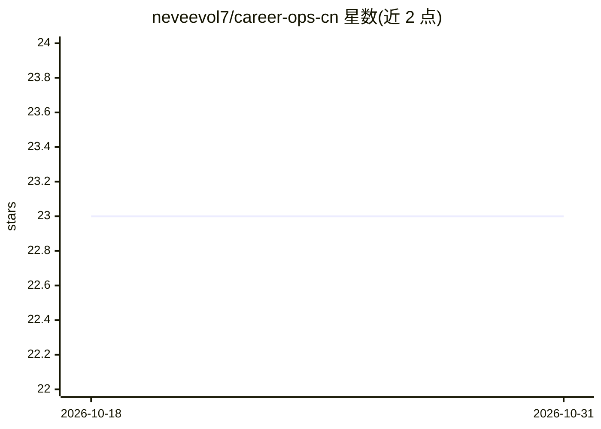

# neveevol7/career-ops-cn

⭐ 23 · JavaScript · MIT · 推送 2026-10-27 · [GitHub](https://github.com/neveevol7/career-ops-cn) · 个人维护

**把 AI 编程 CLI 变成求职命令中心：评分、定制简历、扫描职位**

面向求职者的多 Agent 求职流水线：基于 Claude Code/OpenCode/Gemini CLI 等运行，粘贴职位 URL 即触发自动管道——按 10 个加权维度做 A-F 结构化评分、生成 ATS 优化的定制 PDF 简历、用 Playwright 扫描 Greenhouse/Ashby/Lever 等 45+ 公司门户、并行批量评估，并以 Markdown 表格为单一数据源做去重与健康检查。强调人工把关，系统不自动投递；需先喂入 CV 与职业背景，初期评估质量依赖上下文积累。数据本地存储，MIT 许可。

## 筛选速览

| 维度 | 判定 | 备注 |
|---|---|---|
| AI 角色 | `ai-native` | 本体是模型或模型工具 |
| 许可风险 | `permissive` | MIT |
| 部署形态 | `library` | 以包/库形式分发 |
| 模型依赖 | locked-api |  |
| 硬件要求 | — | 无带数字的原话,不猜 |
| 安装摩擦 | `low` | 无编译、无系统依赖或容器化 |
| 成熟度 | — | 结构信号不足 |

## 能力要点

- 10 加权维度的 A-F 评分与 6 模块评估（含薪酬调研、STAR+R 面试准备）
- Playwright 门户扫描：45+ 预配置公司、19 个搜索查询
- AI 生成 ATS 优化定制 PDF 简历
- Go + Bubble Tea 终端 Dashboard 与人工最终决策机制

## 适用场景

- 批量评估职位并按评分筛选出值得投递的少数机会
- 针对每个职位描述生成定制化简历 PDF
- 自动扫描公司招聘门户并统一跟踪投递状态

## 场景标签

`多智能体` `浏览器自动化` · 领域:Agent 开发

## 证据(README 行号)

> L39: Career-Ops turns any AI coding CLI into a full job search command center. Instead of manually tracking applications
> L49: Career-ops is agentic: Claude Code navigates career pages with Playwright, evaluates fit by reasoning about your CV

## 星数曲线

2026-10-18 23 → 2026-10-31 23（+0）

---
*卡片 v1 · prompt 1.4 · 生成 2026-10-28 · 置信度 high · 依据 README sha `20fd51adeda8` · [字段定义](../../DATASET.md)*
