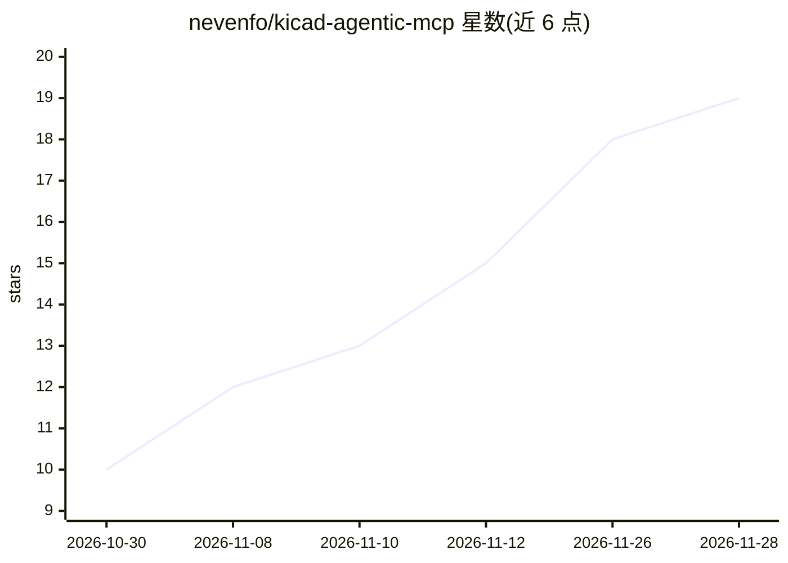

# nevenfo/kicad-agentic-mcp

⭐ 19 · Rust · AGPL-3.0 · 推送 2026-11-09 · [GitHub](https://github.com/nevenfo/kicad-agentic-mcp) · [官网](https://github.com/nevenfo/kicad-agentic-mcp/releases/latest) · 个人维护

**KiCad 10 的 MCP 服务器与 agent 控制层：LLM 规划+确定性执行 PCB 设计**

面向通过 Model Context Protocol 接入的 MCP 客户端（如 Claude Desktop/Claude Code）的 KiCad 10 控制层，服务器二进制名为 konnect，用 Rust 编写。机制：模型只负责把模糊请求转成 Plan IR，计划编译先做引用检查，执行由确定性代码以事务方式完成，带快照回滚、幂等账本与修订检查；正确性判定来自 kicad-cli ERC/DRC 或读回设计，不采信模型自述。原理图走 S-expression 引擎，PCB 走 KiCad IPC API，验证与导出走 kicad-cli。共 217 个工具。限制：本地模型路径自述为“可用但早期”，基准测试仅覆盖原理图与导出路径。

## 筛选速览

| 维度 | 判定 | 备注 |
|---|---|---|
| AI 角色 | `ai-ecosystem` | LLM/agent 周边工具 |
| 许可风险 | `viral` | AGPL-3.0 |
| 部署形态 | `desktop` | 安装包/桌面程序 |
| 模型依赖 | — | README 未给出锁定关系 |
| 硬件要求 | — | 无带数字的原话,不猜 |
| 安装摩擦 | `medium` | 含编译或系统依赖之一 |
| 成熟度 | `idea` | |

## 能力要点

- Plan IR 先编译引用检查，失败在首次变更前拒绝
- 事务执行：目录快照、部分失败回滚、幂等 operation_id 账本
- ERC/DRC 判定来自 kicad-cli，非模型自述；任务状态与证据存于服务端
- 205 个领域工具跨 22 个工具集 + 13 个元工具，启动仅暴露 21 工具起步集

## 适用场景

- 用 MCP 客户端对话放置元件、布线并跑 ERC/DRC 验证
- 生成 Gerber/钻孔/BOM 等制造输出与 fab 包
- 以确定性事务方式批量编辑原理图与 PCB 并可回滚

## 场景标签

 · 领域:电子设计自动化（EDA）

## 证据(README 行号)

> L5: **KiCad Agentic MCP is an MCP server and an agentic control layer for KiCad 10.**
> L6: An MCP client — Claude Desktop, Claude Code, or anything else that speaks the
> L67: The LLM row is the only one a model owns, and it is optional: by default the

## 星数曲线

2026-10-30 10 → 2026-11-28 19（+9）

---
*卡片 v1 · prompt 1.4 · 生成 2026-11-18 · 置信度 high · 依据 README sha `4e2d9c94b77f` · [字段定义](../../DATASET.md)*
