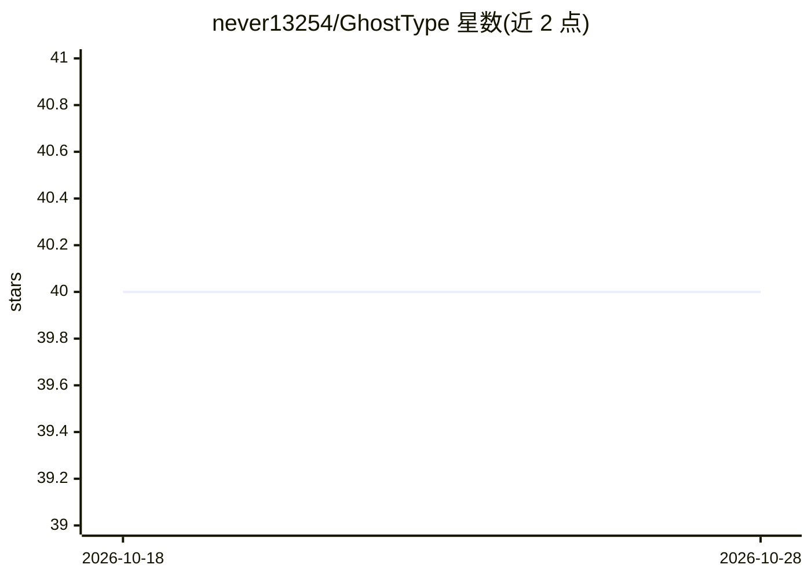

# never13254/GhostType

⭐ 40 · Swift · MIT · 推送 2026-04-15 · [GitHub](https://github.com/never13254/GhostType) · 个人维护 · 中文 README

**macOS 语音效率工具：本地 Whisper 听写 + LLM 改写/翻译，插入光标处**

面向 macOS 用户的菜单栏语音输入应用：按住快捷键说话，本地 Whisper 转录后由 LLM 按上下文改写（识别当前应用/浏览器 URL，路由到 21 个提示词预设），通过辅助功能 API 插入光标位置；另提供对选中文本问答和语音翻译两种模式。ASR 默认本地（MLX Whisper、whisper.cpp、FunASR 等），LLM 支持 DeepSeek/OpenAI/Anthropic 等云端 API、OpenAI 兼容自定义端点（vLLM/Ollama）及本地 MLX（Beta）。要求 macOS 14+ 与 Apple Silicon，本地 MLX LLM 处于测试阶段且内存占用较高，由学生开发者业余维护，Windows/iOS 版在路线图中。

## 筛选速览

| 维度 | 判定 | 备注 |
|---|---|---|
| AI 角色 | `ai-native` | 本体是模型或模型工具 |
| 许可风险 | `permissive` | MIT |
| 部署形态 | `desktop` | 安装包/桌面程序 |
| 模型依赖 | local-ok | 支持本地模型 |
| 硬件要求 | — | 无带数字的原话,不猜 |
| 安装摩擦 | `low` | 无编译、无系统依赖或容器化 |
| 成熟度 | `idea` | |

## 能力要点

- 上下文感知听写：按应用/域名/窗口标题自动路由到 21 个提示词预设
- 三种模式：听写、选中文本问答、语音翻译，快捷键可配置
- 混合引擎：本地 Whisper ASR 默认，LLM 可选云端 API 或本地 MLX（50+ 模型）
- API 密钥存 macOS 钥匙串，零遥测，云端为可选

## 适用场景

- 在任何输入框用语音生成整理好的文字（邮件、IM、笔记、代码）
- 把口语改写成结构化 Prompt 或 Git commit 消息
- 中英混合场景的本地语音转录（不上传音频）
- 用自定义端点接入公司内网或自建 LLM 服务

## 场景标签

`语音识别` `AI 写作` `AI 助手` · 领域:对话与助手

## 证据(README 行号)

> L34: So I built **GhostType**. It listens, understands context, rewrites your words, and types the result directly into 
> L70: |**Dictation**|Speak naturally → polished, structured text inserted at cursor|`Right Option` (hold)|
> L96: |**ASR (Speech-to-Text)**|✅ Stable|**Local Whisper** runs beautifully on Apple Silicon. This is the default and it'

## 星数曲线

2026-10-18 40 → 2026-10-28 40（+0）

---
*卡片 v1 · prompt 1.4 · 生成 2026-10-25 · 置信度 high · 依据 README sha `daf13b9c24c5` · [字段定义](../../DATASET.md)*
