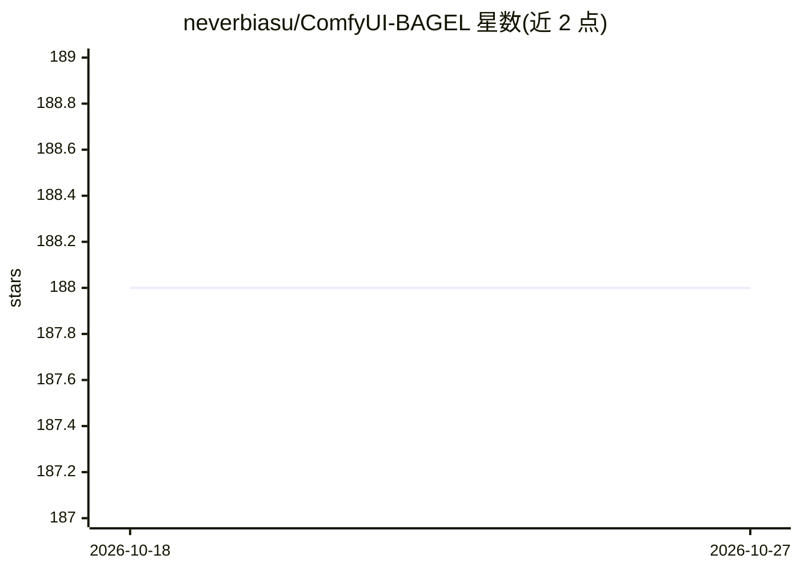

# neverbiasu/ComfyUI-BAGEL

⭐ 188 · Python · Apache-2.0 · 推送 2026-07-31 · [GitHub](https://github.com/neverbiasu/ComfyUI-BAGEL) · 个人维护

**在 ComfyUI 中原生加载运行 BAGEL 多模态模型的自定义节点包**

面向 ComfyUI 用户的自定义节点包，为 BAGEL-7B-MoT（多模态理解与生成统一模型）提供原生模型加载器与三套工作流：文生图、图像编辑、图像理解。推荐从 6chan/bagel_comfy 下载单文件 safetensors 放入 models/bagel，VAE 复用 FLUX AE 与官方 VAELoader；也提供转换脚本处理原始 HF 权重，旧 shard 布局走 deprecated 节点（兼容模式）。README 给出模型/运行时矩阵、各任务 VRAM 数据与未来变体支持路线（含 GGUF/FP8 等量化格式的独立加载路径规划）。

## 筛选速览

| 维度 | 判定 | 备注 |
|---|---|---|
| AI 角色 | `ai-ecosystem` | LLM/agent 周边工具 |
| 许可风险 | `permissive` | Apache-2.0 |
| 部署形态 | `library` | 以包/库形式分发 |
| 模型依赖 | — | README 未给出锁定关系 |
| 硬件要求 | — | 无带数字的原话,不猜 |
| 安装摩擦 | `low` | 无编译、无系统依赖或容器化 |
| 成熟度 | — | 结构信号不足 |

## 能力要点

- BAGEL 原生模型加载器，无需复制原版 config 文件
- 文生图/图像编辑/图像理解三套示例工作流
- 转换脚本将原始 BAGEL/DFloat11 权重转为带校验元数据的单文件
- 模型变体支持矩阵与分阶段验收流程（目录→加载→冒烟→工作流→基准）

## 适用场景

- 在 ComfyUI 中用 BAGEL 做文生图与图像编辑
- 运行 BAGEL 图像理解（图+文→文本）工作流
- 将已有 BAGEL 权重转换后在 ComfyUI 原生节点中使用

## 场景标签

`图像生成` `多模态` · 领域:内容生成

## 证据(README 行号)

> L3: A ComfyUI custom node package for BAGEL-7B-MoT with native ComfyUI model loading.
> L61: |Text-to-image|`example_workflows/bagel_text_to_image.json`|none|Native BAGEL latent generation, official `VAEDecod

## 星数曲线

2026-10-18 188 → 2026-10-27 188（+0）

---
*卡片 v1 · prompt 1.4 · 生成 2026-10-22 · 置信度 mid · 依据 README sha `54fcc228cba5` · [字段定义](../../DATASET.md)*
