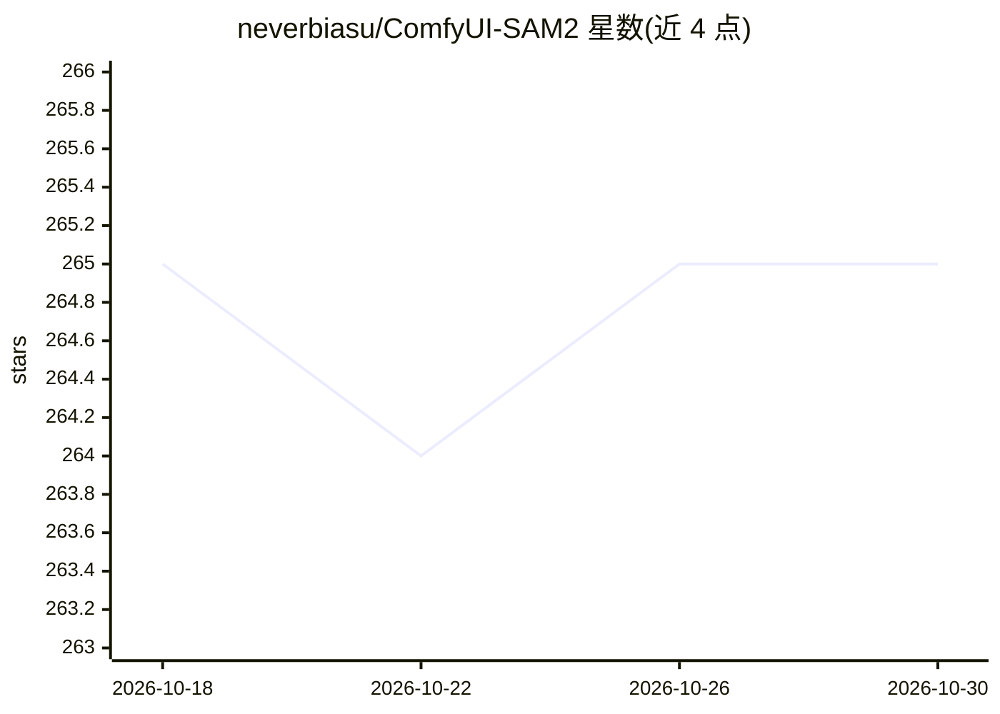

# neverbiasu/ComfyUI-SAM2

⭐ 265 · Python · Apache-2.0 · 推送 2026-07-31 · [GitHub](https://github.com/neverbiasu/ComfyUI-SAM2) · 个人维护

**将 Segment Anything 2 接入 ComfyUI 的图像分割扩展节点**

ComfyUI 自定义节点扩展，把 SAM2（Segment Anything 2）适配进 ComfyUI，并整合 comfyui_segment_anything 的功能，可在 ComfyUI 工作流中执行图像/视频分割。支持 SAM 2 与 SAM 2.1 各规格 checkpoint（tiny 至 large），模型文件可自动下载或手动放置到 models/sam2 目录；同时依赖 BERT Base Uncased 与 GroundingDino 模型（配置于 models/grounding-dino）以实现文本提示检测。安装方式为 pip 安装 requirements.txt，并附示例工作流供快速试用。

## 筛选速览

| 维度 | 判定 | 备注 |
|---|---|---|
| AI 角色 | `ai-ecosystem` | LLM/agent 周边工具 |
| 许可风险 | `permissive` | Apache-2.0 |
| 部署形态 | `library` | 以包/库形式分发 |
| 模型依赖 | — | README 未给出锁定关系 |
| 硬件要求 | — | 无带数字的原话,不猜 |
| 安装摩擦 | `low` | 无编译、无系统依赖或容器化 |
| 成熟度 | — | 结构信号不足 |

## 能力要点

- 在 ComfyUI 中运行 SAM2/SAM 2.1 分割（含 2024-09-29 发布的 2.1 checkpoint）
- 整合 comfyui_segment_anything 的功能
- GroundingDINO SwinT/SwinB 文本提示检测模型支持
- 模型缺失时可自动下载，也可手动放置

## 适用场景

- 在 ComfyUI 工作流中对图像/视频做分割
- 配合 GroundingDino 按文本提示定位并分割目标
- 复用示例工作流快速验证分割效果

## 场景标签

`目标检测` · 领域:感知与多模态

## 证据(README 行号)

> L1: # ComfyUI SAM2(Segment Anything 2)
> L3: This project adapts the SAM2 to incorporate functionalities from comfyui_segment_anything. Many thanks to continue-r

## 星数曲线

2026-10-18 265 → 2026-10-30 265（+0）

---
*卡片 v1 · prompt 1.4 · 生成 2026-10-22 · 置信度 mid · 依据 README sha `ed83973ea536` · [字段定义](../../DATASET.md)*
