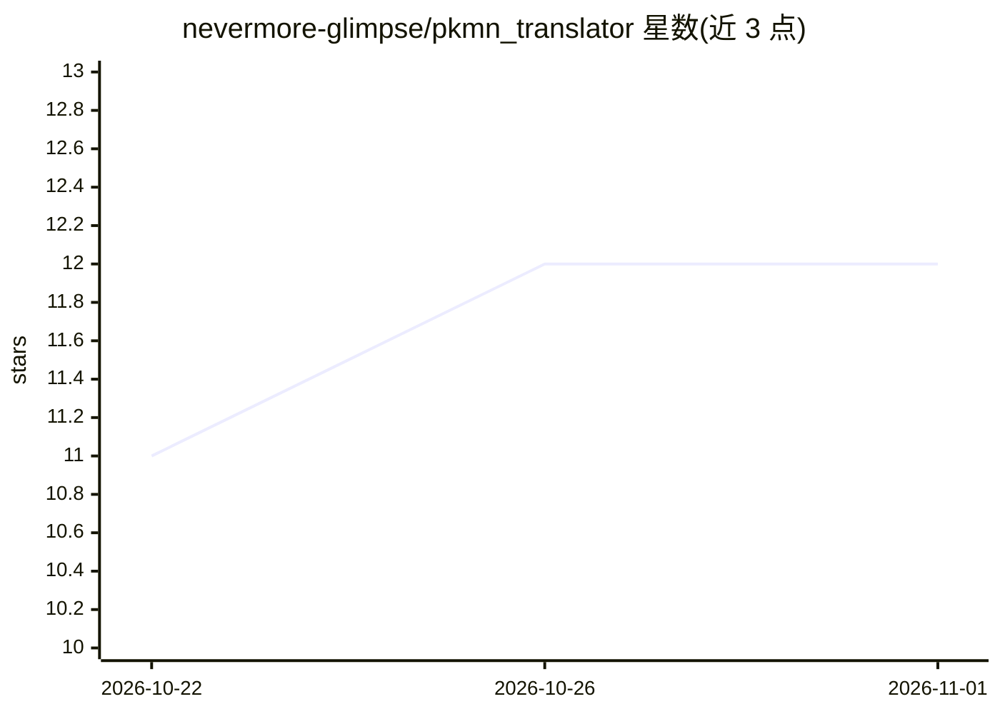

# nevermore-glimpse/pkmn_translator

⭐ 12 · Ruby · MIT · 推送 2026-10-31 · [GitHub](https://github.com/nevermore-glimpse/pkmn_translator) · 个人维护 · 中文 README

**面向玩家的宝可梦同人游戏批量汉化工具，本地/云端 LLM 驱动**

以 LLM 为核心引擎的宝可梦同人游戏（Pokémon Essentials 引擎）汉化工具：从已编译游戏文件提取文本、调用 Ollama 本地模型或 OpenAI 兼容云端 API 批量翻译，再编译回游戏。翻译环节带术语表（Excel 生成、词根派生匹配、整句术语直译）、控制码保护、断点续传、自动检查与重翻、手工改句与术语冲突处理。另附非翻译功能：存档编辑、PBS 文件编辑、开启 DEBUG、换行重排与中文字体插件注入。提供 Windows exe 与 Python 源码两种运行方式，含 GUI 与 CLI。

## 筛选速览

| 维度 | 判定 | 备注 |
|---|---|---|
| AI 角色 | `ai-native` | 本体是模型或模型工具 |
| 许可风险 | `permissive` | MIT |
| 部署形态 | `desktop` | 安装包/桌面程序 |
| 模型依赖 | local-ok | 支持本地模型 |
| 硬件要求 | — | 无带数字的原话,不猜 |
| 安装摩擦 | `low` | 无编译、无系统依赖或容器化 |
| 成熟度 | — | 结构信号不足 |

## 能力要点

- 本地 Ollama / 云端 OpenAI 兼容 API 双模式，支持一键切换 Ollama / llama.cpp / LM Studio / 自定义服务
- 术语表体系：Excel 生成、词根派生匹配、整句术语直译、术语冲突解决
- 控制码保护、断点续传、自动检查报告与重翻、手工改句就地回写
- 中文文本处理插件按 Essentials 17.2–21.1 六个版本自动选择并编译进游戏

## 适用场景

- 我想把英文宝可梦同人游戏的文本批量翻译成中文并编译回游戏
- 我想用官方译名术语表保证宝可梦名称翻译一致
- 我想在不进游戏的情况下编辑存档和 PBS 数据文件
- 我希望全程本地 Ollama 翻译，游戏文本不出本机

## 场景标签

 · 领域:游戏本地化工具

## 证据(README 行号)

> L5: 使用本地 Ollama 大模型批量翻译宝可梦同人游戏文本文件，支持术语表、
> L13: - 🤖 **本地翻译** — 调用 Ollama API，数据不出本机
> L305: - **本地 Ollama**：数据不出本机，参数偏宽松

## 星数曲线

2026-10-22 11 → 2026-11-01 12（+1）

---
*卡片 v1 · prompt 1.4 · 生成 2026-11-01 · 置信度 mid · 依据 README sha `79ace39d78ec` · [字段定义](../../DATASET.md)*
