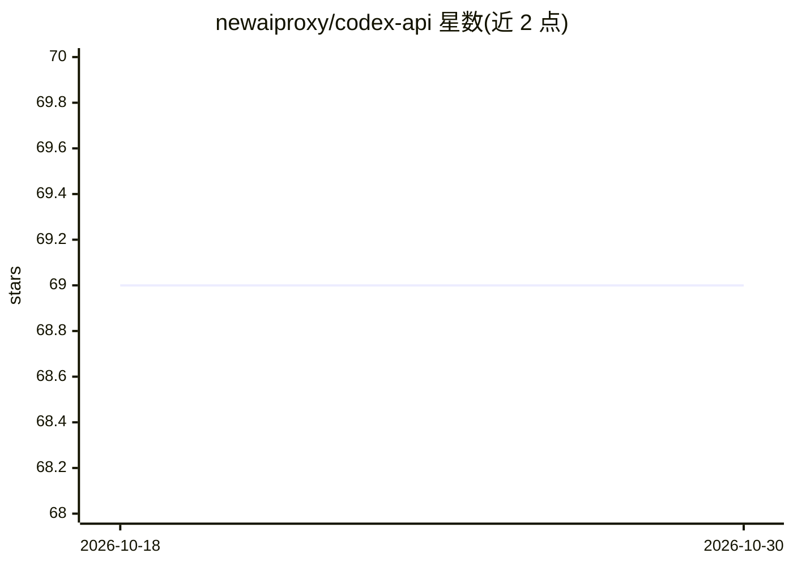

# newaiproxy/codex-api

⭐ 69 · 推送 2026-02-05 · [GitHub](https://github.com/newaiproxy/codex-api) · [官网](https://api.whatai.cc) · 个人维护 · 中文 README

**Codex CLI 安装配置与第三方中转 API 接入的中文教程**

面向开发者的图文教程仓库：讲解 OpenAI Codex CLI 的安装前提（Node.js 22+、npm 10+）、三大平台的 npm 安装与验证步骤，以及如何通过 ~/.codex/ 下的 auth.json 与 config.toml 接入神马中转（whatai）第三方 API 网关。覆盖终端与 VS Code 插件两种使用方式、slash 命令交互习惯，并汇总 9 类常见问题排查（命令找不到、EACCES 权限、401 认证、模型名不匹配、config 不生效等）。仓库本身为文档，不含可运行代码。

## 筛选速览

| 维度 | 判定 | 备注 |
|---|---|---|
| AI 角色 | `ai-knowledge` | 知识聚合/清单类 |
| 许可风险 | `none` | — |
| 部署形态 | `library` | 以包/库形式分发 |
| 模型依赖 | — | README 未给出锁定关系 |
| 硬件要求 | — | 无带数字的原话,不猜 |
| 安装摩擦 | `low` | 无编译、无系统依赖或容器化 |
| 成熟度 | — | 结构信号不足 |

## 能力要点

- Windows/macOS/Linux 三平台 Codex CLI 安装步骤
- auth.json 与 config.toml 接入第三方中转 API 的配置方法
- 9 个 FAQ 排查项（PATH、401、模型名、config 不生效等）
- 终端与 VS Code 插件两种使用流程

## 适用场景

- 我想在终端安装并配置 Codex CLI 接入第三方 API
- 我配置了中转 API Key 但 Codex 报 401/连不上，需要排查
- 我想了解 Codex 的 slash 命令和日常使用习惯

## 场景标签

`教程课程` · 领域:学习与行业

## 证据(README 行号)

> L1: # OpenAI Codex安装配置神马中转API超详细教程，AI编程工具Codex实战配置文件常见错误总结
> L61: ## **配置神马中转API作为第三方API**
> L155: ## **常见问题（FAQ）与排查清单**

## 星数曲线

2026-10-18 69 → 2026-10-30 69（+0）

---
*卡片 v1 · prompt 1.4 · 生成 2026-10-24 · 置信度 mid · 依据 README sha `51da76fac212` · [字段定义](../../DATASET.md)*
