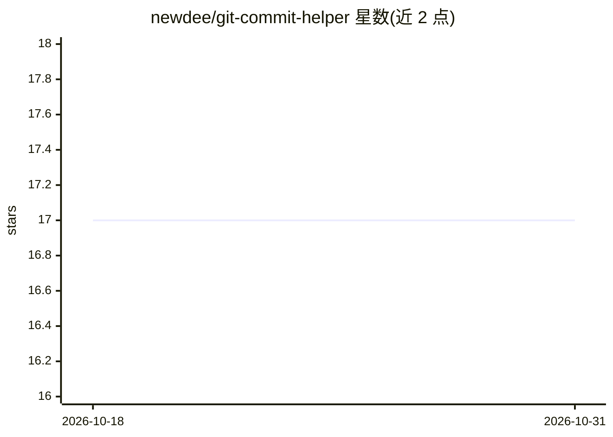

# newdee/git-commit-helper

⭐ 17 · Rust · MIT · 推送 2026-07-17 · [GitHub](https://github.com/newdee/git-commit-helper) · [官网](https://crates.io/crates/git-commit-helper) · 个人维护

**用 LLM 分析 Git 变更并生成 commit 信息的命令行工具**

Rust 编写的 CLI 工具，读取 Git 暂存区的 diff，调用大语言模型生成 commit 信息并提交，面向不愿手写提交信息的开发者。支持 OpenAI、Anthropic、Ollama 三种提供方（一次仅配置一个），未指定模型时按提供方选取默认模型。大于 --chunk-size（默认 200000 字节）的 diff 会按文件边界切分、并发摘要后再生成提交信息，也可调大参数让整个 diff 单次请求处理。可在 lazygit 中调用，通过 cargo install 或 release 包安装。

## 筛选速览

| 维度 | 判定 | 备注 |
|---|---|---|
| AI 角色 | `ai-native` | 本体是模型或模型工具 |
| 许可风险 | `permissive` | MIT |
| 部署形态 | `library` | 以包/库形式分发 |
| 模型依赖 | local-ok | 支持本地模型 |
| 硬件要求 | — | 无带数字的原话,不猜 |
| 安装摩擦 | `low` | 无编译、无系统依赖或容器化 |
| 成熟度 | — | 结构信号不足 |

## 能力要点

- 分析暂存 diff 生成 commit 信息并提交
- 支持 OpenAI / Anthropic / Ollama 三种 LLM 提供方
- 大 diff 按文件边界切分并发摘要，可调 chunk-size 适配长上下文模型
- 可在 lazygit 中使用

## 适用场景

- git add 后让 AI 生成并提交 commit 信息
- 在 lazygit 工作流中快速完成提交
- 大体积变更拆分摘要后生成提交信息

## 场景标签

`AI 写作` · 领域:内容生成

## 证据(README 行号)

> L4: Git Commit Helper is a practical tool that leverages large language models (LLMs) to analyze changes in a Git reposi
> L20: This tool supports **OpenAI, Anthropic, or Ollama** as the language model provider.

## 星数曲线

2026-10-18 17 → 2026-10-31 17（+0）

---
*卡片 v1 · prompt 1.4 · 生成 2026-10-29 · 置信度 high · 依据 README sha `e90c97fd4be3` · [字段定义](../../DATASET.md)*
