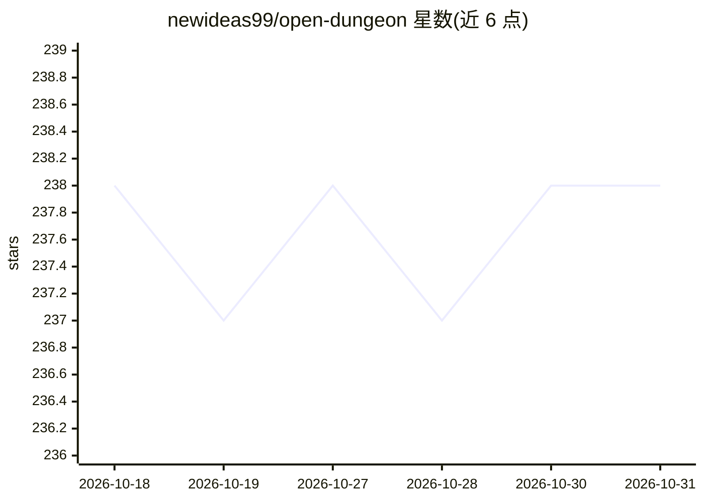

# newideas99/open-dungeon

⭐ 238 · TypeScript · MIT · 推送 2026-07-06 · [GitHub](https://github.com/newideas99/open-dungeon) · 个人维护

**给互动小说玩家的全本地 AI 角色扮演写作应用**

面向互动小说玩家的桌面/本地 Web 应用：文本由 Ollama（Gemma 4 QAT）本地生成，或连接任意 OpenAI 兼容后端（llama.cpp、LM Studio、vLLM、OpenRouter 等），叙述实时流式输出；场景插图通过 generate_image 工具用 FLUX.2-klein 在本机渲染，或指向用户自己的 ComfyUI。提供 Do/Say/Story 三种输入、重试与行内编辑，长故事记忆通过滚动摘要压缩历史；数据存于本地 SQLite，无账号、无 API key。Apple Silicon 提供 DMG，Windows 用启动脚本，其他系统从源码运行，需 Node.js 22+。

## 筛选速览

| 维度 | 判定 | 备注 |
|---|---|---|
| AI 角色 | `ai-native` | 本体是模型或模型工具 |
| 许可风险 | `permissive` | MIT |
| 部署形态 | `library` | 以包/库形式分发 |
| 模型依赖 | local-ok | 支持本地模型 |
| 硬件要求 | — | 无带数字的原话,不猜 |
| 安装摩擦 | `low` | 无编译、无系统依赖或容器化 |
| 成熟度 | — | 结构信号不足 |

## 能力要点

- 文本与场景插图均在本机生成，无账号无 API key
- 支持 Ollama 本地生成或任意 OpenAI 兼容后端连接
- FLUX.2-klein 本机图像生成或对接自有 ComfyUI
- 长故事记忆：旧段落压缩为滚动摘要而非丢弃

## 适用场景

- 离线进行私人 AI 互动小说创作
- 通过手机经 Tailscale 远程继续本地存档的故事
- 用自有 ComfyUI 或后端服务器作为生成引擎

## 场景标签

`AI 写作` `图像生成` · 领域:内容生成

## 证据(README 行号)

> L3: The first **easy-to-use, fully local** AI roleplay app. The story and the
> L9: - **Local text generation** via Ollama (Gemma 4 QAT),
> L13: - **Local image generation** — the narrator calls a `generate_image` tool and

## 星数曲线

2026-10-18 238 → 2026-10-31 238（+0）

---
*卡片 v1 · prompt 1.4 · 生成 2026-10-22 · 置信度 high · 依据 README sha `8224582e4ae2` · [字段定义](../../DATASET.md)*
