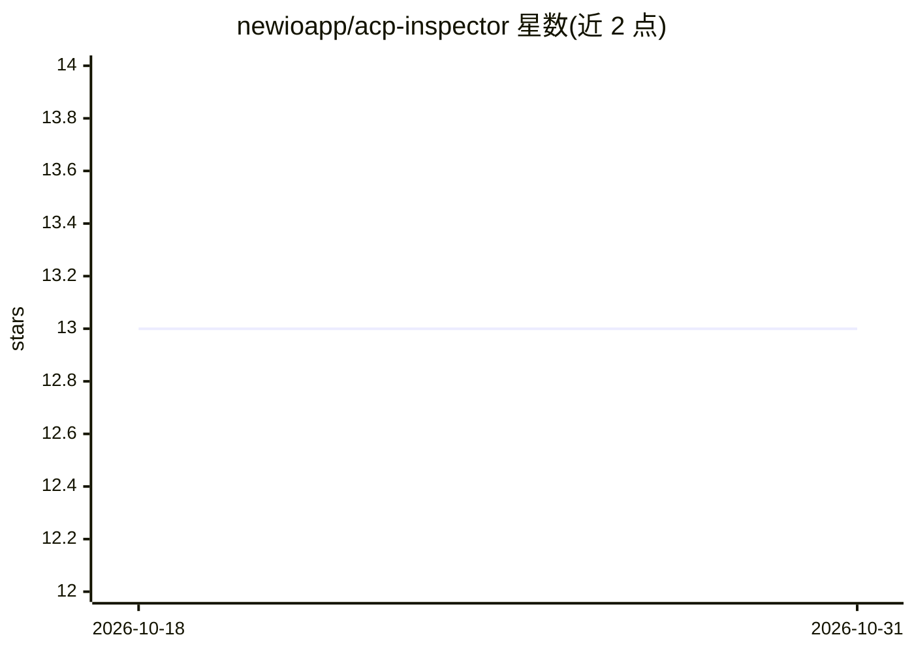

# newioapp/acp-inspector

⭐ 13 · TypeScript · MIT · 推送 2026-06-28 · [GitHub](https://github.com/newioapp/acp-inspector) · [官网](https://github.com/newioapp/acp-inspector/releases) · 组织维护

**测试与调试 ACP 智能体的桌面检视器**

基于 Electron 的桌面应用，面向使用 Agent Client Protocol（ACP，JSON-RPC 协议）的开发者：通过命令行启动并连接任意 ACP 智能体，查看全量协议日志（方向指示、方法过滤、文本搜索），交互式发送提示并观察流式响应，支持会话管理、权限请求应答、环境变量管理与流式输出分组展示。已与 Kiro CLI、Claude Agent ACP、Gemini CLI、Cursor Agent 测试。提供 macOS/Linux 安装包下载。

## 筛选速览

| 维度 | 判定 | 备注 |
|---|---|---|
| AI 角色 | `ai-ecosystem` | LLM/agent 周边工具 |
| 许可风险 | `permissive` | MIT |
| 部署形态 | `desktop` | 安装包/桌面程序 |
| 模型依赖 | — | README 未给出锁定关系 |
| 硬件要求 | — | 无带数字的原话,不猜 |
| 安装摩擦 | `low` | 无编译、无系统依赖或容器化 |
| 成熟度 | — | 结构信号不足 |

## 能力要点

- 通过命令行启动并连接任意 ACP 智能体
- 全量 JSON-RPC 协议日志（方向指示、方法过滤、文本搜索）
- 交互式提示发送、流式响应观察与 session/cancel 中断
- 会话管理与 session/request_permission 权限应答

## 适用场景

- 调试自研 ACP 智能体的协议交互过程
- 检查智能体的能力声明与 MCP 传输、认证方式
- 排查客户端与智能体之间的 JSON-RPC 通信问题

## 场景标签

`LLM 可观测性` · 领域:评测与运维

## 证据(README 行号)

> L3: A desktop app for testing and debugging Agent Client Protocol (ACP)-compatible agents. ACP is an open protocol that 
> L9: - **Connect to any ACP agent** — spawn via command line (e.g. `kiro-cli acp`, `claude-agent-acp`)

## 星数曲线

2026-10-18 13 → 2026-10-31 13（+0）

---
*卡片 v1 · prompt 1.4 · 生成 2026-10-31 · 置信度 mid · 依据 README sha `ded2116351d0` · [字段定义](../../DATASET.md)*
