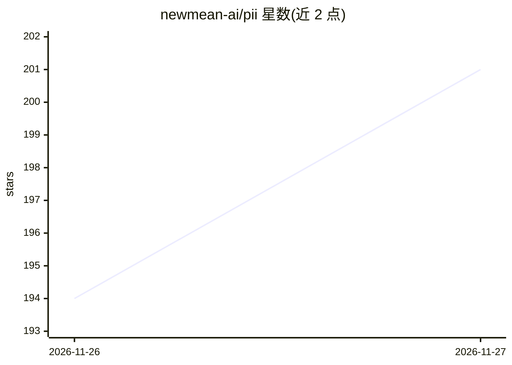

# newmean-ai/pii

⭐ 201 · Python · Apache-2.0 · 推送 2026-11-26 · [GitHub](https://github.com/newmean-ai/pii) · [官网](https://pii.newmean.ai) · 组织维护

**在文本发送给 LLM 前本地遮蔽 PII 的多语言 SDK**

提供检测并遮蔽个人身份信息（人名、邮箱、电话、地址、证件号等）的 SDK，模型在浏览器 WebAssembly 或移动端/服务器本机运行，原文不离开设备；带 vault 机制可在模型回复与允许的工具调用中还原真实值。支持 54 种语言、11+2 标签、四种模型尺寸（2.6–15.5 MB），提供 CSV/TSV 表格模式与 block/allow 用户列表，另附公开数据集、演示站与排行榜。

## 筛选速览

| 维度 | 判定 | 备注 |
|---|---|---|
| AI 角色 | `ai-native` | 本体是模型或模型工具 |
| 许可风险 | `permissive` | Apache-2.0 |
| 部署形态 | `library` | 以包/库形式分发 |
| 模型依赖 | — | README 未给出锁定关系 |
| 硬件要求 | — | 无带数字的原话,不猜 |
| 安装摩擦 | `low` | 无编译、无系统依赖或容器化 |
| 成熟度 | — | 结构信号不足 |

## 能力要点

- 54 种语言、11+2 标签，模型 2.6–15.5 MB 四档尺寸
- 浏览器 WebAssembly 与 iOS/Android/服务器本机运行
- 表格模式输出保持合法 CSV/TSV，支持按列头上下文识别
- block/allow 用户列表在模型加载前校验

## 适用场景

- 把用户文本发给 OpenAI/Anthropic 前先遮蔽个人信息
- 浏览器或手机端离线检测表单与问卷中的 PII
- 对 CSV/TSV 数据导出做批量脱敏

## 场景标签

`网络安全` · 领域:学习与行业

## 证据(README 行号)

> L5: **Mask PII before it reaches OpenAI, Anthropic or any LLM.** Detect and mask personal information (names, emails, ph
> L9: - Four model sizes: **nano 2.6 MB**, **small 7.1 MB**, **medium 11.3 MB** (default), **large 15.5 MB**
> L10: - Runs in WebAssembly: the SDK's own built-in engine (default, about 13 KB) or onnxruntime-web

## 星数曲线

2026-11-26 194 → 2026-11-27 201（+7）

---
*卡片 v1 · prompt 1.4 · 生成 2026-11-27 · 置信度 high · 依据 README sha `71551461e4cf` · [字段定义](../../DATASET.md)*
