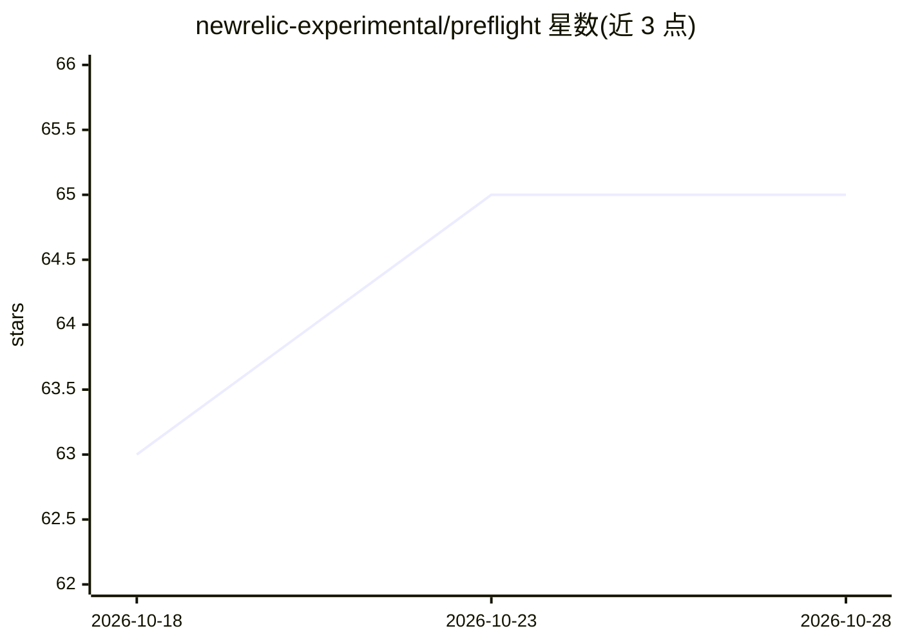

# newrelic-experimental/preflight

⭐ 65 · TypeScript · Apache-2.0 · 推送 2026-10-27 · [GitHub](https://github.com/newrelic-experimental/preflight) · [官网](https://newrelic-experimental.github.io/preflight/) · 组织维护

**AI 编程助手的可观测性工具：成本追踪与效率评分**

面向使用 Claude Code、Cursor、Copilot 等 AI 编程助手的开发者与团队，捕获每一次工具调用（文件读写、命令、搜索），提供美元成本追踪、按模型与缓存的成本拆分、预算告警与月度消耗预测；以 0–100 效率分与反模式检测（重复读取、盲目编辑、卡死循环）评估 AI 工作方式。本地优先：默认全部数据留在本机，localhost:7777 提供实时面板；可选连接 New Relic 获取团队汇总、告警与跨会话历史（8 个预置仪表盘）。通过 hooks 与 MCP server 接入各编程工具，覆盖深度因平台而异（Zed/Continue.dev/Cline 仅能看到路由到其 MCP 工具的调用）。需 Node.js v22+，npm/Homebrew/源码均可安装。

## 筛选速览

| 维度 | 判定 | 备注 |
|---|---|---|
| AI 角色 | `ai-ecosystem` | LLM/agent 周边工具 |
| 许可风险 | `permissive` | Apache-2.0 |
| 部署形态 | `desktop` | 安装包/桌面程序 |
| 模型依赖 | — | README 未给出锁定关系 |
| 硬件要求 | — | 无带数字的原话,不猜 |
| 安装摩擦 | `low` | 无编译、无系统依赖或容器化 |
| 成熟度 | — | 结构信号不足 |

## 能力要点

- 捕获 AI 编程助手的每次工具调用并追踪美元成本（按模型与缓存拆分）
- 0–100 效率评分与反模式检测（重复读取、盲目编辑、卡死循环）
- 本地优先：默认数据不出本机，localhost:7777 实时面板无需账号
- 支持 18 种编程工具，可选连接 New Relic 获取团队看板与告警

## 适用场景

- 看清我的 AI 编程助手每会话花了多少钱、做了什么
- 发现 AI 反复卡在循环或重复读文件等低效模式
- 团队管理者汇总多名开发者的 AI 成本与效率指标

## 场景标签

`LLM 可观测性` · 领域:评测与运维

## 证据(README 行号)

> L16: **Preflight is observability for agentic coding** — the actions, cost, and efficiency of your AI coding assistant a
> L122: Coverage isn't uniform — some platforms capture every built-in tool call, others (Zed, Continue.dev, Cline) only s

## 星数曲线

2026-10-18 63 → 2026-10-28 65（+2）

---
*卡片 v1 · prompt 1.4 · 生成 2026-10-24 · 置信度 high · 依据 README sha `5365b7a984e2` · [字段定义](../../DATASET.md)*
