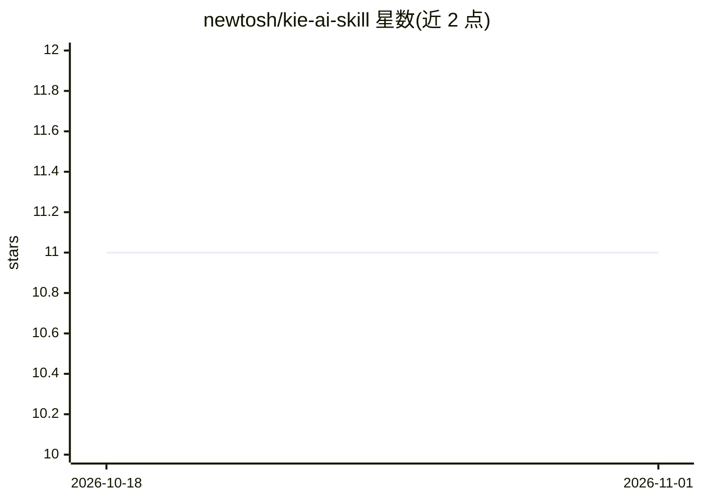

# newtosh/kie-ai-skill

⭐ 11 · Python · MIT · 推送 2026-02-20 · [GitHub](https://github.com/newtosh/kie-ai-skill) · 个人维护

**为 OpenClaw agent 提供 kie.ai 统一 AI 模型调用的技能封装**

kie.ai API 的命令行封装，设计为 OpenClaw 的技能模块：通过 kie-ai.sh 调用 Nano Banana Pro (Gemini 3 Pro)、Flux Kontext、4o-image 等模型生成图像，支持可选的 Google Drive 上传（经 maton.ai OAuth 网关）、本地文件保存、任务历史与费用估算；视频（Veo 3.1、Runway）与音乐（Suno）生成标注为 coming soon。使用需 kie.ai API key 与充值积分，图像通过 API 中转计费。

## 筛选速览

| 维度 | 判定 | 备注 |
|---|---|---|
| AI 角色 | `ai-ecosystem` | LLM/agent 周边工具 |
| 许可风险 | `permissive` | MIT |
| 部署形态 | `None` |  |
| 模型依赖 | — | README 未给出锁定关系 |
| 硬件要求 | — | 无带数字的原话,不猜 |
| 安装摩擦 | `low` | 无编译、无系统依赖或容器化 |
| 成熟度 | — | 结构信号不足 |

## 能力要点

- kie-ai.sh 命令行封装，接入多种图像生成模型
- 本地保存生成文件，可选自动上传 Google Drive
- 本地任务历史与积分/美元费用估算
- 通过符号链接安装为 OpenClaw 技能

## 适用场景

- 给 OpenClaw agent 添加图像生成技能
- 在脚本或命令行中调用 kie.ai 的多模型图像生成
- 跟踪 AI 生成任务的费用消耗

## 场景标签

`图像生成` · 领域:内容生成

## 证据(README 行号)

> L1: # kie.ai API Wrapper for OpenClaw
> L59:    ln -s ~/src/kie-ai-skill ~/.openclaw/workspace/skills/kie-ai-skill

## 星数曲线

2026-10-18 11 → 2026-11-01 11（+0）

---
*卡片 v1 · prompt 1.4 · 生成 2026-11-01 · 置信度 high · 依据 README sha `c1c25209f60a` · [字段定义](../../DATASET.md)*
