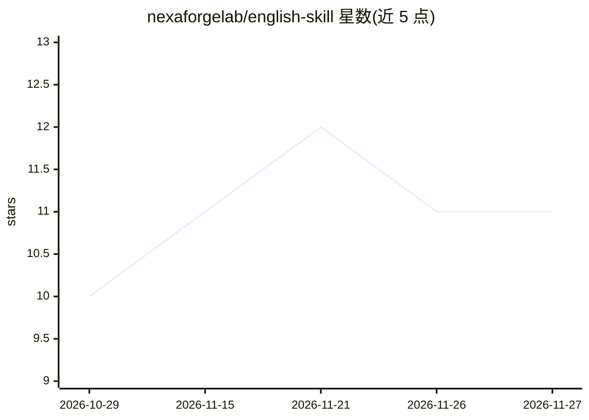

# nexaforgelab/english-skill

⭐ 11 · Python · Apache-2.0 · 推送 2026-05-26 · [GitHub](https://github.com/nexaforgelab/english-skill) · 组织维护 · 中文 README

**面向 AI Agent/提示工程的 100 个开源英语学习技能库**

以 SKILL.md 技能文件为核心的可组合英语学习系统，每个技能附带运行脚本、校验脚本、技能画像 JSON 与默认启动 prompt，覆盖词汇、语法、发音、听力、口语、阅读、写作、考试、商务、留学等场景。根目录提供共享运行时，支持 Markdown/JSON 输出、学习事件记录、基于 SQLite 与 SM2 的复习项生成及批量审计。要求 Python 3.10+，通过 git clone 获取，面向 agent、提示工程师、教育者与语言学习产品开发者。

## 筛选速览

| 维度 | 判定 | 备注 |
|---|---|---|
| AI 角色 | `ai-knowledge` | 知识聚合/清单类 |
| 许可风险 | `permissive` | Apache-2.0 |
| 部署形态 | `None` |  |
| 模型依赖 | — | README 未给出锁定关系 |
| 硬件要求 | — | 无带数字的原话,不猜 |
| 安装摩擦 | `low` | 无编译、无系统依赖或容器化 |
| 成熟度 | — | 结构信号不足 |

## 能力要点

- 100 个技能覆盖词汇/语法/发音/听说读写/考试/商务等 8 大类
- 每个技能含 SKILL.md、运行脚本、校验脚本与 skill_profile.json
- 共享运行时支持学习事件记录、SM2 复习项生成与批量审计
- 提供中英文使用指南与场景学习指南

## 适用场景

- 为 AI Agent 添加英语教学类可执行技能
- 按 B1 等水平生成一周英语学习计划
- 用校验脚本批量审计技能资源完整性

## 场景标签

`提示工程` · 领域:Agent 开发

## 证据(README 行号)

> L3: > 100 open-source AI-agent skills for English learning, with executable training scaffolds, structured skill profile
> L9: English Skill 是一个面向 AI Agent / Codex / Prompt 工程的英语学习技能库。它不是单一聊天提示词，而是一套可组合的学习系统：100 个 skill 覆盖词汇、语法、发音、听力、口语、阅读、写作、
> L23: English Skill is an open-source collection of AI-agent skills for English learning. It is designed for agents, prom

## 星数曲线

2026-10-29 10 → 2026-11-27 11（+1）

---
*卡片 v1 · prompt 1.4 · 生成 2026-11-18 · 置信度 high · 依据 README sha `21d8b69e477b` · [字段定义](../../DATASET.md)*
