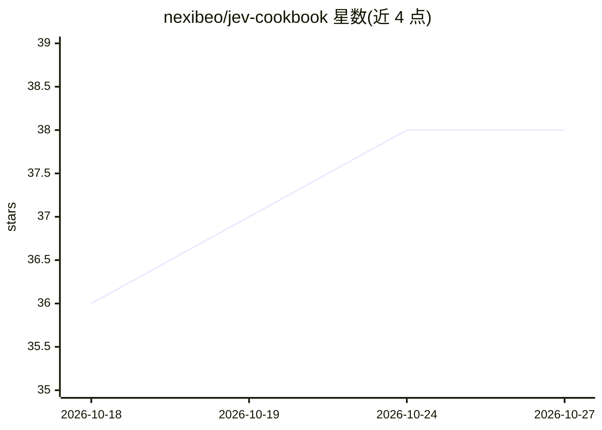

# nexibeo/jev-cookbook

⭐ 38 · JavaScript · MIT · 推送 2026-09-26 · [GitHub](https://github.com/nexibeo/jev-cookbook) · [官网](https://nexibeo.com) · 个人维护

**Jev 决策模型的实用配方集：15 个可运行任务脚本**

面向 OpenRouter 上 TypeSafe 的 Jev 决策模型（非对话模型）的实例集：每个配方含可运行脚本、小型标注数据集与实测结果，任务覆盖工单分诊、数据库索引、文件整理、多标签打标、去重、PII 列扫描、发票抽取、搜索重排、审核、浏览器 agent 等。核心机制是把数据构造为 state，用 Choice/Noul/Score 三种题型一次调用返回带概率的类型化答案，代码端按置信度路由。需要 Node 22.9+ 与 OpenRouter key。

## 筛选速览

| 维度 | 判定 | 备注 |
|---|---|---|
| AI 角色 | `ai-native` | 本体是模型或模型工具 |
| 许可风险 | `permissive` | MIT |
| 部署形态 | `library` | 以包/库形式分发 |
| 模型依赖 | locked-api |  |
| 硬件要求 | — | 无带数字的原话,不猜 |
| 安装摩擦 | `low` | 无编译、无系统依赖或容器化 |
| 成熟度 | — | 结构信号不足 |

## 能力要点

- 15 个配方各含可运行脚本、标注数据集与实测结果
- 一次调用返回带概率的类型化答案（Choice/Noul/Score）
- 共享客户端库 ask()/choice()/noul()/route() 与正则候选提取器
- 各配方按置信度路由，中间段交人工复核

## 适用场景

- 用 Jev 做工单分诊、打标、去重、PII 识别等结构化决策任务
- 参考配方学习如何设计 state 与题型提问
- 在浏览器自动化任务中用 Jev 决定每步点击与输入

## 场景标签

`浏览器自动化` `教程课程` · 领域:效率与自动化

## 证据(README 行号)

> L13: Jev is not a chat model. You send it some data (the `state`) and a set of questions with fixed answers, and it retu
> L23: const res = await fetch('https://openrouter.ai/api/alpha/decisions', {

## 星数曲线

2026-10-18 36 → 2026-10-27 38（+2）

---
*卡片 v1 · prompt 1.4 · 生成 2026-10-25 · 置信度 mid · 依据 README sha `32230f4e4bae` · [字段定义](../../DATASET.md)*
