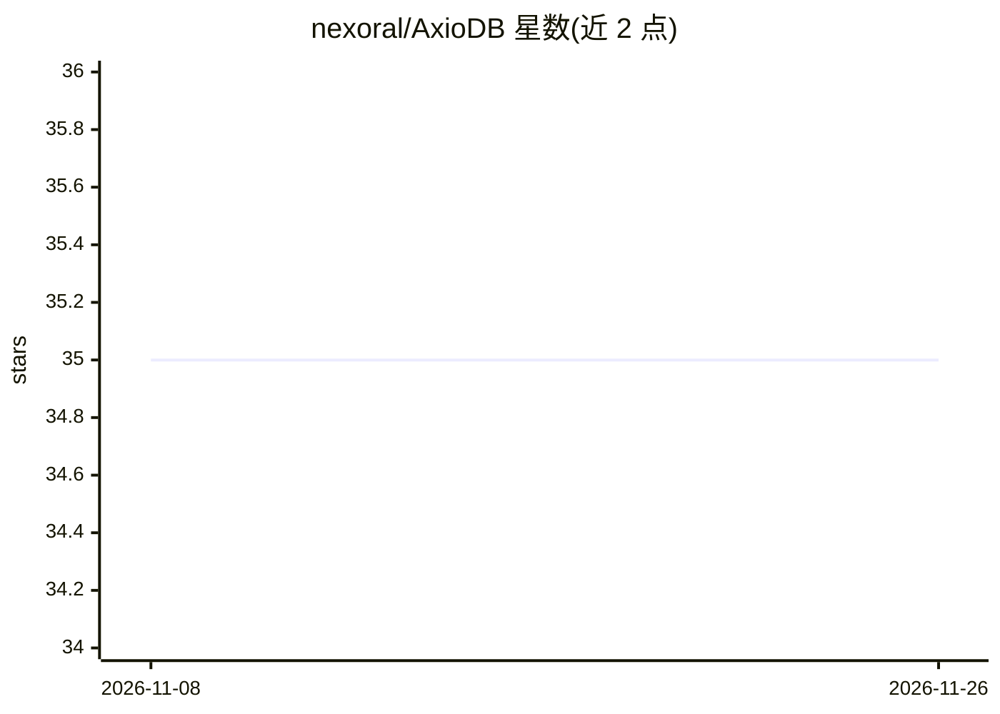

# nexoral/AxioDB

⭐ 35 · TypeScript · MIT · 推送 2026-11-23 · [GitHub](https://github.com/nexoral/AxioDB) · [官网](https://axiodb.in) · 个人维护

**面向 AI Agent 的嵌入式文档数据库，零服务端运行**

纯 JavaScript/TypeScript 实现的零依赖嵌入式数据库，通过 `new AxioDB()` 直接嵌入 Node.js/Bun/Deno/Electron 应用，无需数据库服务器、无 C++ 编译。提供 ACID 事务、WAL、内存缓存、类 Mongo 查询操作符与聚合连接；内置精确 k-NN 向量搜索（Cosine/Dot/Euclidean），可通过嵌入式、HTTP、TCP 及 MCP 接口访问，MCP 模式启动后向 Claude、Cursor 等 agent 提供 46 个工具。定位 1,000–500,000 文档规模，README 明确不建议用于海量记录与分布式集群。附带 Electron 桌面应用、Go CLI 与 Docker 镜像等可选工具。面向构建 agent 记忆与 RAG 的开发者。

## 筛选速览

| 维度 | 判定 | 备注 |
|---|---|---|
| AI 角色 | `ai-ecosystem` | LLM/agent 周边工具 |
| 许可风险 | `permissive` | MIT |
| 部署形态 | `self-host` | docker 或自建部署 |
| 模型依赖 | — | README 未给出锁定关系 |
| 硬件要求 | — | 无带数字的原话,不猜 |
| 安装摩擦 | `low` | 无编译、无系统依赖或容器化 |
| 成熟度 | — | 结构信号不足 |

## 能力要点

- 纯 JS/TS 零原生依赖，无 node-gyp，嵌入式运行
- ACID 事务与 WAL，崩溃时未完成写入自动回滚
- 内置精确 k-NN 向量搜索，支持混合查询+向量过滤
- 内置 MCP Server（46 工具）、HTTP REST 与 TCP 服务面

## 适用场景

- 为 AI agent 本地保存对话历史、工具调用与状态
- 做 agent 情景记忆与 RAG 的语义检索
- Electron 桌面应用内嵌数据库，免运行数据库服务器

## 场景标签

`Agent 记忆` `向量数据库` · 领域:Agent 开发

## 证据(README 行号)

> L3:  Embedded Database for AI Agents
> L97: * 🤖 **Built-in AI Agent MCP Server** — Pass `{ MCP: true }` to instantly boot an official Model Context Protocol se
> L73: * **AI Semantic Search & RAG** — Perform exact k-NN vector similarity search for agent episodic memory and retrieva

## 星数曲线

2026-11-08 35 → 2026-11-26 35（+0）

---
*卡片 v1 · prompt 1.4 · 生成 2026-11-18 · 置信度 high · 依据 README sha `adcd31327e87` · [字段定义](../../DATASET.md)*
