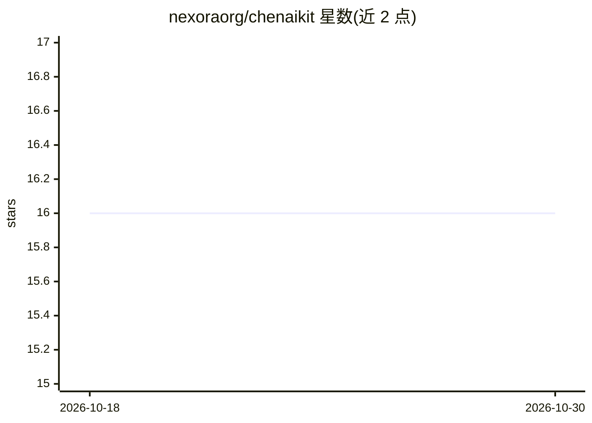

# nexoraorg/chenaikit

⭐ 16 · TypeScript · 推送 2026-09-16 · [GitHub](https://github.com/nexoraorg/chenaikit) · [官网](https://chenaikit.vercel.app) · 组织维护

**将 AI 模型接入 Stellar 区块链的开发者工具包**

chenaikit 是一个 monorepo，包含 Soroban 智能合约、Express+Prisma 后端 API、前端 Web 应用、共享 TS 包和 Python ML pipeline，用于把 AI 能力（聊天机器人、评分、推荐）与 Stellar 区块链集成。安装方式为 pnpm（install/build/test），合约部分通过 cargo build/test 构建；集成测试由测试装置自动处理环境变量，无需外部数据库配置或生产凭据。前端样式由共享设计令牌驱动。

## 筛选速览

| 维度 | 判定 | 备注 |
|---|---|---|
| AI 角色 | `ai-ecosystem` | LLM/agent 周边工具 |
| 许可风险 | `none` | — |
| 部署形态 | `library` | 以包/库形式分发 |
| 模型依赖 | — | README 未给出锁定关系 |
| 硬件要求 | — | 无带数字的原话,不猜 |
| 安装摩擦 | `low` | 无编译、无系统依赖或容器化 |
| 成熟度 | — | 结构信号不足 |

## 能力要点

- monorepo 结构：合约、后端 API、前端、共享 TS 包、Python ML pipeline 五部分
- 集成测试无需外部数据库配置或生产凭据
- 提供 Soroban 合约的 cargo 构建/测试流程

## 适用场景

- 在 Stellar/Soroban 上构建结合 AI 评分或推荐的应用
- 搭建带后端 API 与前端的区块链+AI 全栈项目原型

## 场景标签

 · 领域:区块链/AI 集成开发

## 证据(README 行号)

> L3: A monorepo for chenaikit: Soroban smart contracts, a backend API, a frontend
> L4: web app, shared TS packages, and a Python ML pipeline.

## 星数曲线

2026-10-18 16 → 2026-10-30 16（+0）

---
*卡片 v1 · prompt 1.4 · 生成 2026-10-30 · 置信度 low · 依据 README sha `151d66c635f6` · [字段定义](../../DATASET.md)*
