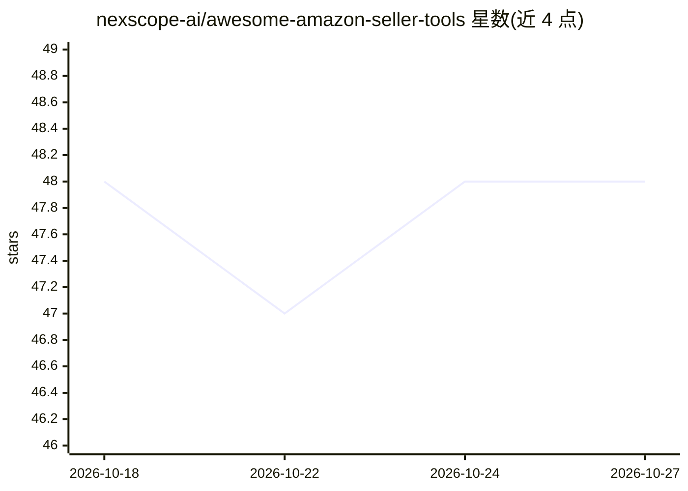

# nexscope-ai/awesome-amazon-seller-tools

⭐ 48 · 推送 2026-08-26 · [GitHub](https://github.com/nexscope-ai/awesome-amazon-seller-tools) · 组织维护

**面向亚马逊卖家的电商工具与 AI agent 策展清单**

由 nexscope-ai 维护的 Awesome 类清单，收录亚马逊卖家生态的工具、软件与 AI agents，按功能分为全合一平台、产品研究、关键词研究、listing 优化、PPC 广告、评论管理、定价、库存、利润分析、理赔、产品摄影、选品供应链、市场情报、免费工具、社区/播客/博客/课程等类别，宣称为 2026 年更新并新增 AI Agents & Skills 分类，条目兼容 OpenClaw、Claude Code、Cursor 等 agent 的 Skills 格式。

## 筛选速览

| 维度 | 判定 | 备注 |
|---|---|---|
| AI 角色 | `ai-knowledge` | 知识聚合/清单类 |
| 许可风险 | `none` | — |
| 部署形态 | `library` | 以包/库形式分发 |
| 模型依赖 | — | README 未给出锁定关系 |
| 硬件要求 | — | 无带数字的原话,不猜 |
| 安装摩擦 | `low` | 无编译、无系统依赖或容器化 |
| 成熟度 | — | 结构信号不足 |

## 能力要点

- 按功能组织覆盖卖家运营全链条的工具条目
- 新增 AI Agents & Skills 分类，兼容 Skills 格式的 agent 框架
- 含免费工具表格、社区、播客、博客与课程资源

## 适用场景

- 寻找适合自己运营环节的亚马逊卖家工具
- 了解 AI agent 在亚马逊卖家场景的技能生态
- 按功能对比产品研究、PPC、定价等类别工具

## 场景标签

`精选清单` · 领域:学习与行业

## 证据(README 行号)

> L3: > A curated list of tools, software, and AI agents for Amazon sellers. Updated for 2026.
> L16: **The next wave of Amazon seller tools.** AI agents automate research, analysis, and operations — no manual clickin

## 星数曲线

2026-10-18 48 → 2026-10-27 48（+0）

---
*卡片 v1 · prompt 1.4 · 生成 2026-10-25 · 置信度 mid · 依据 README sha `c624feeb525a` · [字段定义](../../DATASET.md)*
