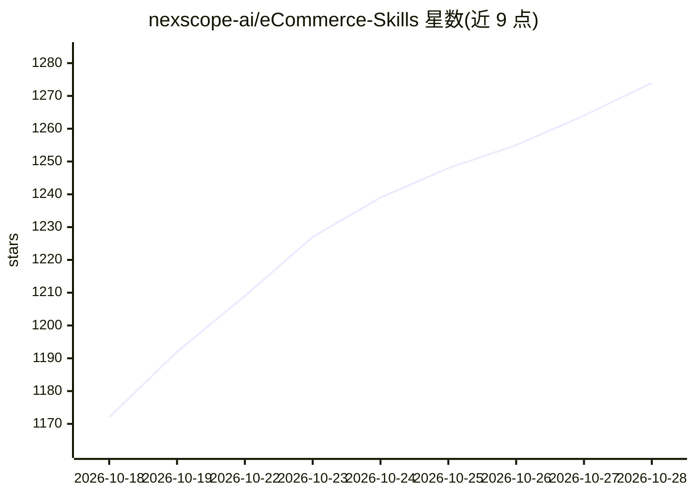

# nexscope-ai/eCommerce-Skills

⭐ 1,283 · Python · MIT · 推送 2026-08-26 · [GitHub](https://github.com/nexscope-ai/eCommerce-Skills) · 组织维护

**面向电商卖家的 AI agent 技能集合（157 条，markdown 指令文件）**

由 Nexscope 维护的电商领域 AI agent 技能库：157 个以 markdown 纯文本形式组织的技能文件，覆盖 Amazon、Shopify、eBay、Etsy、TikTok Shop、Walmart 平台的定价利润计算、增长策略、营销、listing 优化、广告、品牌保护、供应链与运营分析等场景。技能为无二进制、无 API key 的指令文件，兼容 OpenClaw、Claude Code、Cursor、Windsurf、Codex 等 Skills 兼容 agent，通过 npx skills 命令一次性或按名称安装，部分技能标注 Beta 状态。

## 筛选速览

| 维度 | 判定 | 备注 |
|---|---|---|
| AI 角色 | `ai-knowledge` | 知识聚合/清单类 |
| 许可风险 | `permissive` | MIT |
| 部署形态 | `library` | 以包/库形式分发 |
| 模型依赖 | — | README 未给出锁定关系 |
| 硬件要求 | — | 无带数字的原话,不猜 |
| 安装摩擦 | `low` | 无编译、无系统依赖或容器化 |
| 成熟度 | `idea` | |

## 能力要点

- 157 个技能按 8 个电商类别组织（竞争分析、定价、增长、营销、listing、广告、监控、供应链、运营）
- 纯 markdown 指令文件，无二进制与 API key，任意 LLM 可读取
- npx skills add 命令支持批量或按名称安装
- 覆盖 6 个主流电商平台与部分跨平台技能

## 适用场景

- 电商卖家为 AI 助手安装定价、PPC、listing 优化等专业技能
- 跨境卖家获取 VAT/IOSS/GST 合规与市场评分分析
- 品牌方做评论真实性检查与跨平台品牌保护

## 场景标签

 · 领域:电商/AI agent 技能

## 证据(README 行号)

> L5: **157 free AI agent skills for Amazon, Shopify, eBay, Etsy, TikTok Shop & Walmart sellers.**
> L41: E-commerce skills are plain-text instruction files that give AI agents specialized expertise in selling online. No 

## 星数曲线

2026-10-18 1,172 → 2026-10-28 1,274（+102）

---
*卡片 v1 · prompt 1.4 · 生成 2026-10-21 · 置信度 high · 依据 README sha `10d7023d4d25` · [字段定义](../../DATASET.md)*
