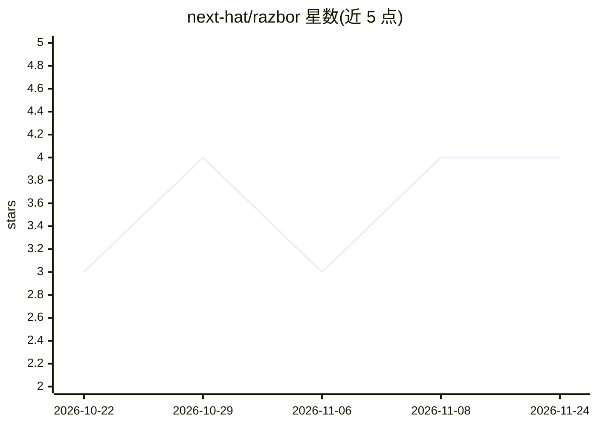

# next-hat/razbor

⭐ 4 · TypeScript · Apache-2.0 · 推送 2026-11-19 · [GitHub](https://github.com/next-hat/razbor) · 组织维护

**自托管的 AI 代码审查机器人，接入 Forgejo/GitHub/GitLab**

面向自托管场景的 AI 代码审查服务：将仓库接入 Forgejo、GitHub 或 GitLab 后，通过评论命令请求审查，模型检查 diff 与周边代码并发布摘要与行内发现；支持对 PR 开启持续审查或对每个就绪 PR 自动审查，可回复发现进行讨论，Web 控制台集中管理 PR、审查历史与 worker 状态。模型端点由用户自选（OpenAI Responses 或 Anthropic Messages 协议），worker 以 Kata 隔离运行，代码在本地检出。部署需 Linux amd64、Docker 与 Kata runtime。

## 筛选速览

| 维度 | 判定 | 备注 |
|---|---|---|
| AI 角色 | `ai-native` | 本体是模型或模型工具 |
| 许可风险 | `permissive` | Apache-2.0 |
| 部署形态 | `self-host` | docker 或自建部署 |
| 模型依赖 | — | README 未给出锁定关系 |
| 硬件要求 | — | 无带数字的原话,不猜 |
| 安装摩擦 | `low` | 无编译、无系统依赖或容器化 |
| 成熟度 | — | 结构信号不足 |

## 能力要点

- 通过 /agentic_review 评论命令触发审查，输出摘要与行内发现
- 自选模型端点：OpenAI Responses 或 Anthropic Messages 协议
- 支持仓库指令、可复用技能、Codebase Memory 与可选语义搜索
- Worker 使用 Kata 隔离，源码本地检出，仅相关代码发送到模型端点

## 适用场景

- 为自托管 Forgejo/GitLab 实例的 PR 自动执行代码审查
- 在自有基础设施上运行审查流程且代码不出本地
- 按置信度配置审查升级与受保护的自动合并策略

## 场景标签

`代码审查` · 领域:编码与开发

## 证据(README 行号)

> L5:  Self-hosted AI code reviews for Forgejo, GitHub, and GitLab.
> L13: Razbor checks the diff and surrounding code, then posts a summary and inline
> L18: - **Bring your model.** Connect an OpenAI Responses or Anthropic Messages endpoint.

## 星数曲线

2026-10-22 3 → 2026-11-24 4（+1）

---
*卡片 v1 · prompt 1.4 · 生成 2026-11-21 · 置信度 mid · 依据 README sha `69637c94901e` · [字段定义](../../DATASET.md)*
