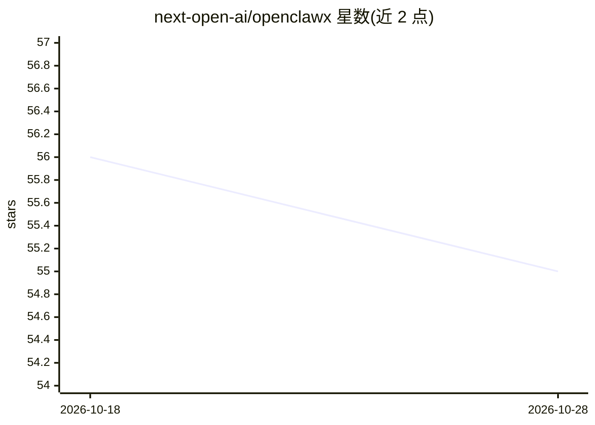

# next-open-ai/openclawx

⭐ 55 · TypeScript · 推送 2026-10-20 · [GitHub](https://github.com/next-open-ai/openclawx) · 组织维护 · 中文 README

**跨平台本地优先的桌面级「数字员工」AI Agent 工作台**

OpenClawX 是 Electron + Vue + Fastify 构建的桌面 Agent 工作台：用户配置「数字员工」（模型、Skills、权限档位），由服务端状态机承载会话、项目、审批与运行。支持 Skills 渐进加载、知识库（本地 LanceDB）与本体检索、MCP 连接（http/sse/stdio）、多搜索商、任务中心、数据对象与 AI 参数化 SQL、实时语音，以及通过网关接入 Telegram/飞书与远程中继终端。执行后端默认 pi，可选 AgentScope（需 Python ≥3.10）与 dsh sidecar。本地 embedding sidecar 处于演进中。提供桌面安装包、npm CLI、Web Launcher 与 Docker 四种运行形态。

## 筛选速览

| 维度 | 判定 | 备注 |
|---|---|---|
| AI 角色 | `ai-native` | 本体是模型或模型工具 |
| 许可风险 | `none` | — |
| 部署形态 | `desktop` | 安装包/桌面程序 |
| 模型依赖 | — | README 未给出锁定关系 |
| 硬件要求 | — | 无带数字的原话,不猜 |
| 安装摩擦 | `low` | 无编译、无系统依赖或容器化 |
| 成熟度 | `idea` | |

## 能力要点

- 服务端状态机承载会话/审批/项目，桌面 UI、网关与远程终端共享状态
- Skills 渐进加载：先授权元信息，按需读取 SKILL.md，隔离运行工作区执行
- 通道网关：Telegram/飞书适配器 + 个人白名单，远程中继设备出连供终端调度
- 四种运行形态：Desktop 安装包、npm CLI、Web Launcher、Docker

## 适用场景

- 在桌面配置带 Skills 与知识库的数字员工执行项目任务
- 通过 Telegram/飞书远程调度本地数字员工
- 用可续跑审批机制管控工具执行（waiting-approval 后自动续跑）

## 场景标签

`工作流自动化` `AI 助手` · 领域:效率与自动化

## 证据(README 行号)

> L9: OpenClawX 是一套桌面级 Agent 工作台：其中的“数字员工”可以对话、运行**项目编排**、使用 **Skills**、检索**知识库 / MCP 连接 / 联网搜索**、管理**资产与自动化**，并且能通过**本地通道
> L45: |数字员工|职责与授权载体：可配模型、Skills、运行时偏好与权限档位（read-only/default/extended/full）|

## 星数曲线

2026-10-18 56 → 2026-10-28 55（-1）

---
*卡片 v1 · prompt 1.4 · 生成 2026-10-24 · 置信度 high · 依据 README sha `598c385904ff` · [字段定义](../../DATASET.md)*
