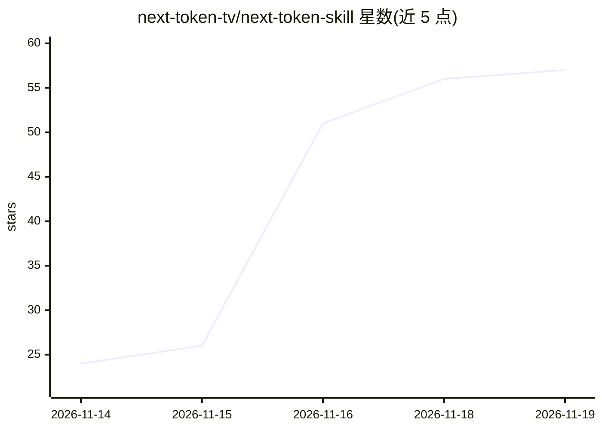

# next-token-tv/next-token-skill

⭐ 57 · Python · Apache-2.0 · 推送 2026-11-12 · [GitHub](https://github.com/next-token-tv/next-token-skill) · [官网](https://nexttoken.tv) · 组织维护 · 中文 README

**让 AI Agent 检索 Next Token 播客逐字稿并附时间戳链接的 Skill**

为 AI Agent 提供的播客知识检索技能：将《Next Token｜词元之外》全部节目的逐字稿和文章同步到本地缓存，Agent 回答 AI 相关问题时检索节目内容，引用四位主理人观点并附 B 站/YouTube 时间戳链接。零依赖，仅用 Python 标准库，无向量库、不需 API Key；链接从官网文字稿页面原样取得。支持 Claude Code（符号链接安装）及其他能读说明、能运行命令的 Agent，也可终端直接使用 search/brief/timeline 等子命令。限制：约三成段落时间为近似值，依赖官网页面结构，不适用于无法运行本地脚本的环境。

## 筛选速览

| 维度 | 判定 | 备注 |
|---|---|---|
| AI 角色 | `ai-knowledge` | 知识聚合/清单类 |
| 许可风险 | `permissive` | Apache-2.0 |
| 部署形态 | `None` |  |
| 模型依赖 | — | README 未给出锁定关系 |
| 硬件要求 | — | 无带数字的原话,不猜 |
| 安装摩擦 | `low` | 无编译、无系统依赖或容器化 |
| 成熟度 | — | 结构信号不足 |

## 能力要点

- 全部节目逐字稿与文章同步本地，检索不请求网站
- 引用主理人观点并附 B 站/YouTube 时间戳直跳链接
- 零依赖：仅 Python 标准库，无需向量库与 API Key
- 提供 search/brief/related/timeline/read 等终端命令

## 适用场景

- 问 AI 问题时获得播客主理人的观点引用与出处链接
- 按时间线追踪某话题在各期节目中的说法变化
- 把播客观点用于自己做产品、选模型、写内容的分析

## 场景标签

`文档问答` · 领域:知识与检索

## 证据(README 行号)

> L24: 每期一个多小时，不一定有时间听完。这个 skill 把全部节目的逐字稿和文章交给你的 Agent：你照常提问，它帮你找到节目里相关的那几句话，并把你带到视频的对应位置。
> L72: 把 `next-token` 整个目录放进该 Agent 的 skills 目录即可。它只包含一份说明（`SKILL.md`）和一个脚本（`scripts/nexttoken.py`），任何能读说明、能运行命令的 Agent 都可

## 星数曲线

2026-11-14 24 → 2026-11-19 57（+33）

---
*卡片 v1 · prompt 1.4 · 生成 2026-11-18 · 置信度 high · 依据 README sha `e981cac52a0a` · [字段定义](../../DATASET.md)*
