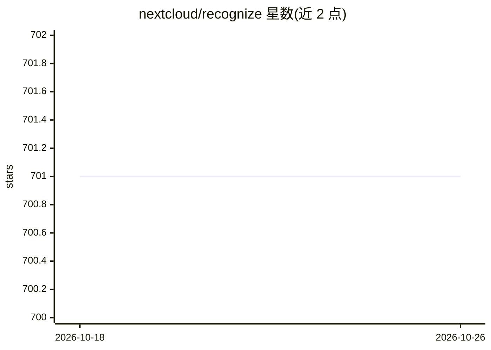

# nextcloud/recognize

⭐ 701 · PHP · AGPL-3.0 · 推送 2026-10-25 · [GitHub](https://github.com/nextcloud/recognize) · [官网](https://apps.nextcloud.com/apps/recognize) · 组织维护

**Nextcloud 媒体自动打标应用：识别人脸、物体、地标、音乐与视频动作**

Nextcloud 服务端应用，扫描用户媒体库并通过预训练模型自动生成标签：人脸识别与按人脸分组照片（GUI 在 memories 应用）、物体/动物/风景/食物/车辆识别、地标识别、音乐流派分类、视频人体动作识别。标签通过 Nextcloud 协作标签机制落地。推理在本地 Node.js 中以 TensorFlow.js 完成，不向云端发送数据；模型体积从 50MB 到 1GB 不等。需 php 8.0+ 与约 4GB 空闲内存，x86 64 位（带 AVX）为原生速度，其他架构走 WASM 模式。端到端加密文件无法处理。

## 筛选速览

| 维度 | 判定 | 备注 |
|---|---|---|
| AI 角色 | `ai-native` | 本体是模型或模型工具 |
| 许可风险 | `viral` | AGPL-3.0 |
| 部署形态 | `self-host` | docker 或自建部署 |
| 模型依赖 | — | README 未给出锁定关系 |
| 硬件要求 | — | 无带数字的原话,不猜 |
| 安装摩擦 | `low` | 无编译、无系统依赖或容器化 |
| 成熟度 | — | 结构信号不足 |

## 能力要点

- 人脸识别与按人脸分组照片，物体、地标、音乐流派、视频动作多类识别
- 全部推理在本地 Node.js/ TensorFlow.js 完成，不发送数据到云服务商
- 通过 Nextcloud 协作标签写入结果，memories 与 audioplayer 应用可消费标签
- 提供 Ethical AI Rating：多数模型训练数据开放，音乐流派模型训练数据不开放

## 适用场景

- 我想让自托管 Nextcloud 网盘里的照片自动按人脸和物体分类
- 给音乐库自动标注流派并用 audioplayer 播放
- 对视频进行人体动作识别并自动打标

## 场景标签

`人脸识别` `目标检测` · 领域:感知与多模态

## 证据(README 行号)

> L5: This app goes through your media collection and adds fitting tags, automatically categorizing your photos and music.
> L7: * 📷 👪 Recognizes faces and groups photos by faces that appear in them (GUI in the memories app)
> L62: This app does not send any sensitive data to cloud providers or similar services. All image processing is done on y

## 星数曲线

2026-10-18 701 → 2026-10-26 701（+0）

---
*卡片 v1 · prompt 1.4 · 生成 2026-10-21 · 置信度 mid · 依据 README sha `cc7e0ea0b527` · [字段定义](../../DATASET.md)*
