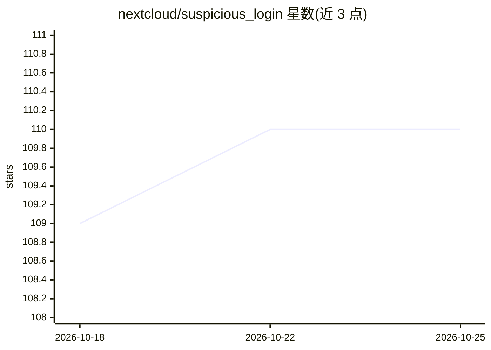

# nextcloud/suspicious_login

⭐ 110 · PHP · AGPL-3.0 · 推送 2026-10-22 · [GitHub](https://github.com/nextcloud/suspicious_login) · 组织维护

**检测并告警 Nextcloud 可疑 IP 登录的应用**

随 Nextcloud Server 25 及以上版本内置的 PHP 应用：追踪成功登录的 (IP, uid) 元组，聚合成训练数据，在收集约 60 天数据后每日后台训练神经网络模型；模型就绪后对登录进行分类，将判定为可疑的记录写入 suspicious_login 表并发出通知。训练与超参数优化也可通过 OCC 命令行手动触发（优化用模拟退火，可能耗时数小时至数天）。应用密码认证的请求不参与可疑判定。

## 筛选速览

| 维度 | 判定 | 备注 |
|---|---|---|
| AI 角色 | `ai-native` | 本体是模型或模型工具 |
| 许可风险 | `viral` | AGPL-3.0 |
| 部署形态 | `library` | 以包/库形式分发 |
| 模型依赖 | — | README 未给出锁定关系 |
| 硬件要求 | — | 无带数字的原话,不猜 |
| 安装摩擦 | `low` | 无编译、无系统依赖或容器化 |
| 成熟度 | `idea` | |

## 能力要点

- 追踪并聚合 (IP, uid) 登录数据，原始数据压缩后删除以省空间
- 默认 60 天数据后每日后台训练神经网络
- OCC 命令 suspiciouslogin:train 手动训练，--stats 查看模型性能
- 模拟退火超参数优化命令 suspiciouslogin:optimize

## 适用场景

- Nextcloud 实例自动识别来自可疑 IP 的登录并通知管理员
- 手动触发模型训练或超参数优化
- 调整通知中的 IP 信息查询链接配置

## 场景标签

`网络安全` · 领域:学习与行业

## 证据(README 行号)

> L49: When enough data is collected – which by default is 60 days (!) – a first
> L90: As soon as the first model is trained, the app will start classifying (IP, uid) tuples

## 星数曲线

2026-10-18 109 → 2026-10-25 110（+1）

---
*卡片 v1 · prompt 1.4 · 生成 2026-10-23 · 置信度 mid · 依据 README sha `d2ede19cc948` · [字段定义](../../DATASET.md)*
