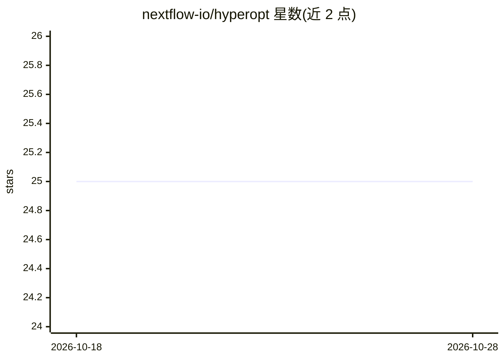

# nextflow-io/hyperopt

⭐ 25 · Python · MPL-2.0 · 推送 2026-05-26 · [GitHub](https://github.com/nextflow-io/hyperopt) · 组织维护

**Nextflow 机器学习模型超参数优化流程（概念验证）**

基于 Nextflow 的工作流，用于机器学习模型的超参数优化：从 OpenML 下载或读取用户提供的数据集，划分训练/测试集并可视化，训练多种模型类型（默认 dummy/gb/lr/mlp/rf），逐一评估并按评估分数报告每个数据集的最佳模型。依赖 Unix-like 系统、Java >=17 与 Conda 或 Docker，通过 nextflow run 启动，可运行在本地、HPC 集群或云端；Python 依赖由 conda.yml 定义。自述为 proof-of-concept。

## 筛选速览

| 维度 | 判定 | 备注 |
|---|---|---|
| AI 角色 | `ai-ecosystem` | LLM/agent 周边工具 |
| 许可风险 | `permissive` | MPL-2.0 |
| 部署形态 | `None` |  |
| 模型依赖 | — | README 未给出锁定关系 |
| 硬件要求 | — | 无带数字的原话,不猜 |
| 安装摩擦 | `low` | 无编译、无系统依赖或容器化 |
| 成熟度 | `idea` | |

## 能力要点

- 从 OpenML 拉取数据集并自动划分训练/测试集
- 训练并评估多种模型类型，按评估分数报告最佳模型
- 借助 Nextflow 抽象可在本地、HPC 集群或云上执行
- 支持 Conda 原生或 Wave 容器（Docker）两种运行方式

## 适用场景

- 用工作流方式批量训练并比较多个 ML 模型
- 在自己的数据集上跑自动化超参数优化
- 在 HPC 或云环境中复现模型选型流程

## 场景标签

`MLOps` · 领域:训练与推理

## 证据(README 行号)

> L3: A proof-of-concept pipeline for performing hyperparameter optimization of machine learning models with Nextflow.
> L41: 4. Train a variety of models on each training set
> L43: 6. Report the best model for each dataset based on evaluation score

## 星数曲线

2026-10-18 25 → 2026-10-28 25（+0）

---
*卡片 v1 · prompt 1.4 · 生成 2026-10-27 · 置信度 high · 依据 README sha `941fe90b2880` · [字段定义](../../DATASET.md)*
