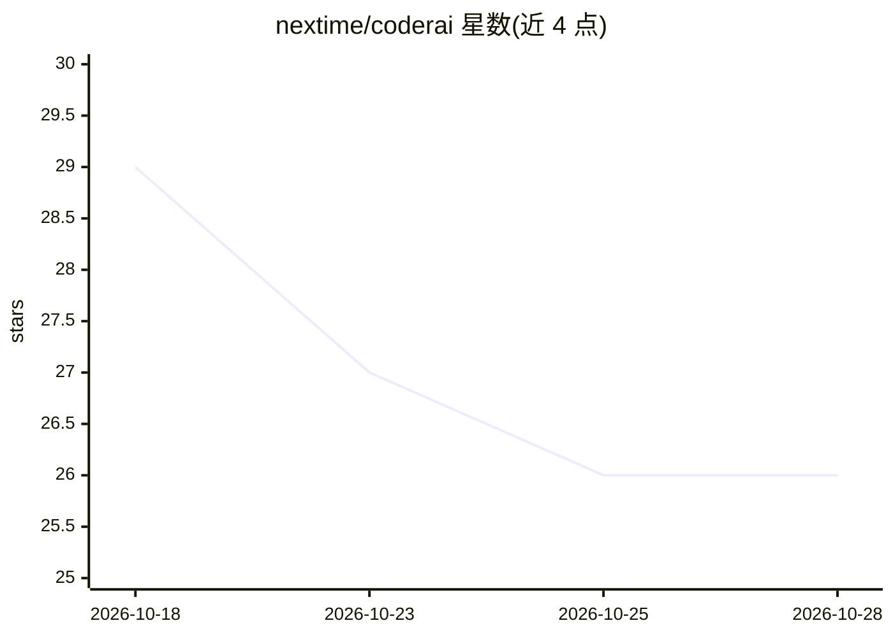

# nextime/coderai

⭐ 26 · Python · GPL-3.0 · 推送 2026-10-28 · [GitHub](https://github.com/nextime/coderai) · [官网](https://aisbf.cloud/coderai/) · 个人维护

**多后端本地/云端 GPU 模型编排器，暴露 OpenAI 兼容 API**

CoderAI 是一个多模态、多后端的模型编排器，通过 OpenAI 兼容 API 服务器在本地 GPU（NVIDIA CUDA、AMD/Intel Vulkan）或远程租用 GPU 上运行文本、图像、视频、语音、embedding、OCR 及 LoRA 训练。核心机制：统一前端口按能力、负载与模型绑定将请求路由到不同推理引擎（transformers/llama.cpp/vLLM/ds4/colibri/k3/kt 等）；支持模型跨多机分布（llama.cpp RPC、vLLM on Ray、SGLang 多节点）、集群节点 mDNS 自动发现，以及算力不足时升级到 RunPod 按秒租用 GPU（含预算与计费控制）。全部配置由 JSON 文件驱动，提供 Web Studio 与管理面板。

## 筛选速览

| 维度 | 判定 | 备注 |
|---|---|---|
| AI 角色 | `ai-ecosystem` | LLM/agent 周边工具 |
| 许可风险 | `viral` | GPL-3.0 |
| 部署形态 | `desktop` | 安装包/桌面程序 |
| 模型依赖 | local-ok | 支持本地模型 |
| 硬件要求 | — | 无带数字的原话,不猜 |
| 安装摩擦 | `low` | 无编译、无系统依赖或容器化 |
| 成熟度 | — | 结构信号不足 |

## 能力要点

- OpenAI 兼容 API，单一入口路由到 9 种推理引擎
- 模型跨多机分布与集群编排（mDNS 自动发现、前缀缓存感知路由）
- 本地 GPU 不足时按秒租用 RunPod GPU，含费率上限与支出预算
- 多模态覆盖：文本/图像/视频/语音/embedding/OCR 与 LoRA/QLoRA 训练

## 适用场景

- 在本地多张/多类 GPU 上统一运行和调度 LLM 与多模态模型
- 把多台机器组成集群跑单个大模型或分布式生成与训练
- 本地算力不够时自动迁移到按秒计费的云端 GPU

## 场景标签

`推理引擎` `图像生成` `视频生成` `微调` · 领域:内容生成

## 证据(README 行号)

> L9: A multimodal and multi-backend local model orchestrator with an OpenAI-compatible API server to run models on local 
> L19: - **OpenAI-Compatible API**: Drop-in replacement for OpenAI's API endpoints
> L60: Beyond the built-in `transformers` and `gguf` paths, CoderAI can drive external native

## 星数曲线

2026-10-18 29 → 2026-10-28 26（-3）

---
*卡片 v1 · prompt 1.4 · 生成 2026-10-27 · 置信度 mid · 依据 README sha `d1706c126f41` · [字段定义](../../DATASET.md)*
