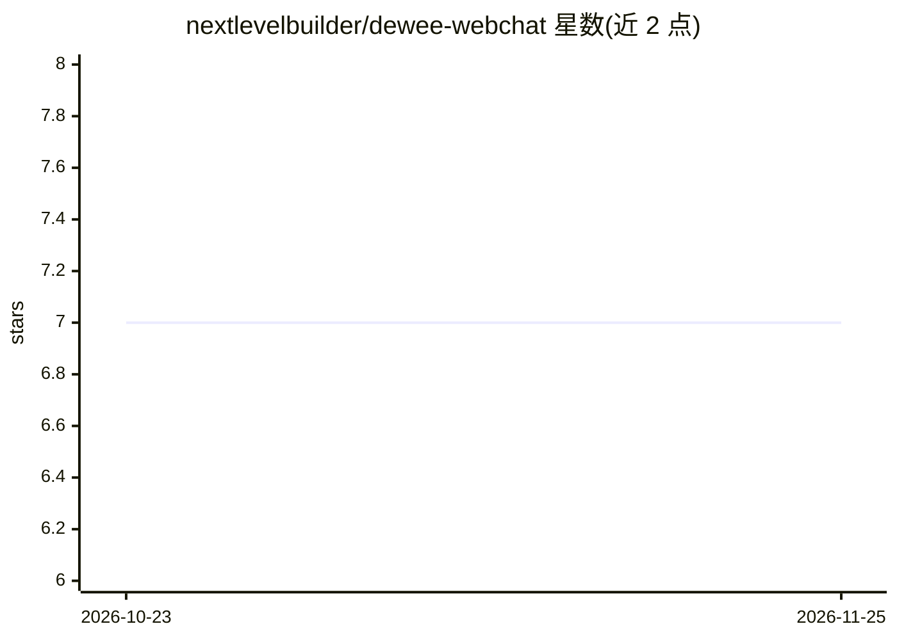

# nextlevelbuilder/dewee-webchat

⭐ 7 · TypeScript · MIT · 推送 2026-11-14 · [GitHub](https://github.com/nextlevelbuilder/dewee-webchat) · [官网](https://webchat.dewee.sh) · 组织维护

**为 Dewee AI agent 提供可嵌入网站的聊天挂件**

Web component 形式的嵌入聊天挂件：站点添加一个 <dewee-chat> 标签即可让访客与 Dewee agent 对话，支持流式输出、markdown、历史记录与多 agent 切换。架构上前端只持访客 token，集成密钥保存在自建后端 handler（支持 Workers/Next.js/Astro/Node/Bun/Deno/PHP），经 SSE 转发至 Dewee CCP。登录用户可通过 identity.authenticate 回调换取短期身份会话，使用其私有工具，并可一键关联 Telegram/Discord；PHP 后端仅支持匿名访客。

## 筛选速览

| 维度 | 判定 | 备注 |
|---|---|---|
| AI 角色 | `ai-native` | 本体是模型或模型工具 |
| 许可风险 | `permissive` | MIT |
| 部署形态 | `library` | 以包/库形式分发 |
| 模型依赖 | — | README 未给出锁定关系 |
| 硬件要求 | — | 无带数字的原话,不猜 |
| 安装摩擦 | `low` | 无编译、无系统依赖或容器化 |
| 成熟度 | — | 结构信号不足 |

## 能力要点

- 单个 script 标签嵌入，支持流式回答、markdown、历史与 agent 切换
- 集成密钥仅存于自建后端 handler，多运行时（Workers/Next.js/Node/Bun/Deno/PHP）可挂载
- 登录用户身份回调换取短期会话，agent 以验证用户身份使用私有工具
- 提供 React/Vue/Astro 封装与 8 个可运行集成示例

## 适用场景

- 给网站接入 Dewee agent 聊天入口
- 为登录用户提供带身份和私有工具的对话
- 用 PHP 或 Worker 等自建后端托管集成密钥

## 场景标签

`聊天机器人` · 领域:对话与助手

## 证据(README 行号)

> L3: Embeddable chat for Dewee agents. Drop one tag on any site and visitors talk to your
> L11: browser <dewee-chat>  ──HTTPS + SSE──▶  your backend /api/dewee/*  ──HTTPS + SSE──▶  Dewee CCP (Website chat)
> L22: 2. Mount the backend handler at `/api/dewee/*` (Workers, Next.js, Astro, Node, Bun, Deno, or the PHP file).

## 星数曲线

2026-10-23 7 → 2026-11-25 7（+0）

---
*卡片 v1 · prompt 1.4 · 生成 2026-11-20 · 置信度 high · 依据 README sha `e675ba655f59` · [字段定义](../../DATASET.md)*
