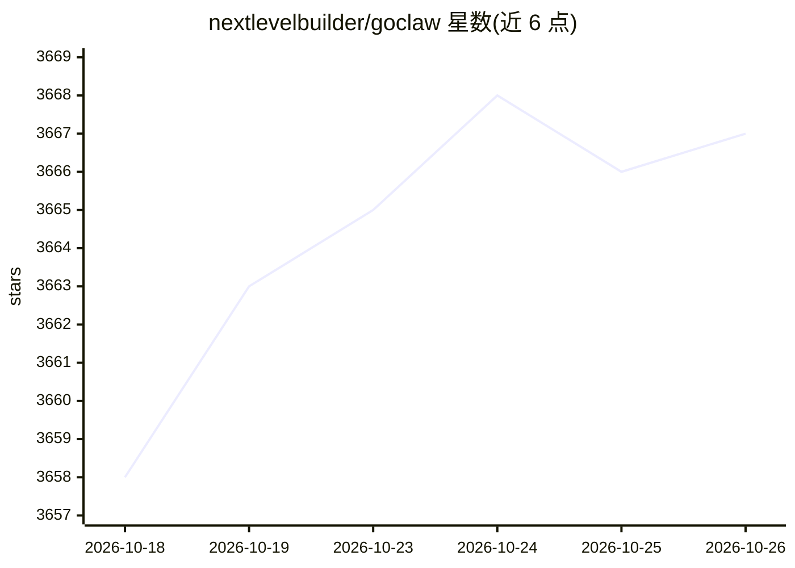

# nextlevelbuilder/goclaw

⭐ 3,667 · Go · NOASSERTION · 推送 2026-10-22 · [GitHub](https://github.com/nextlevelbuilder/goclaw) · [官网](https://goclaw.sh) · 个人维护 · 中文 README

**Go 编写的多租户多 Agent AI 网关平台**

GoClaw 是用 Go 重写的 OpenClaw，定位多租户 AI Agent 平台：8 阶段 Agent 流水线、3 层记忆（会话/情景/知识图谱）、文档知识库（wikilinks + BM25/pgvector 混合检索）、Agent 团队编排与委派、20+ LLM 适配器（AES-256-GCM 加密 API key）与 7 个消息渠道。安全含 5 层权限、限流、注入检测、SSRF 防护。编译为约 25MB 单二进制；另有 GoClaw Lite 桌面版（Wails + React + SQLite，最多 5 个 Agent）。服务端需 PostgreSQL + pgvector，可选 Docker 与 Easypanel 一键部署。注意默认分支为 dev，许可证为 CC BY-NC 4.0（非商业）。

## 筛选速览

| 维度 | 判定 | 备注 |
|---|---|---|
| AI 角色 | `ai-ecosystem` | LLM/agent 周边工具 |
| 许可风险 | `none` | NOASSERTION |
| 部署形态 | `desktop` | 安装包/桌面程序 |
| 模型依赖 | locked-api |  |
| 硬件要求 | — | 无带数字的原话,不猜 |
| 安装摩擦 | `low` | 无编译、无系统依赖或容器化 |
| 成熟度 | — | 结构信号不足 |

## 能力要点

- 8 阶段 Agent 流水线与 4 模式提示系统
- 多 Agent 团队编排：共享任务板、同步/异步委派、3 种编排模式
- 20+ LLM 提供商统一适配接口，API key AES-256-GCM 加密
- 单二进制约 25MB，另提供 SQLite 桌面版 GoClaw Lite

## 适用场景

- 部署多租户 AI Agent 团队并通过 Telegram/Discord/Slack 等渠道交互
- 用 Docker 或单二进制在低配 VPS 上自托管 Agent 网关
- 本地运行桌面版 AI Agent（无 Docker、无 PostgreSQL）
- 通过 Webhook API 从外部系统触发 Agent

## 场景标签

`多智能体` `聊天机器人` `Agent 框架` · 领域:Agent 开发

## 证据(README 行号)

> L5: Multi-agent AI gateway built in Go. 20+ LLM providers. 7 channels. Multi-tenant PostgreSQL.
> L62: - **20+ LLM Providers** — Anthropic (native HTTP+SSE with prompt caching), OpenAI, OpenRouter, Requesty, Groq, Deep
> L255: 20+ LLM providers unified through a single adapter interface. Capability-based routing, encrypted API keys (AES-25

## 星数曲线

2026-10-18 3,658 → 2026-10-26 3,667（+9）

---
*卡片 v1 · prompt 1.4 · 生成 2026-10-20 · 置信度 high · 依据 README sha `e83a4a5125b1` · [字段定义](../../DATASET.md)*
