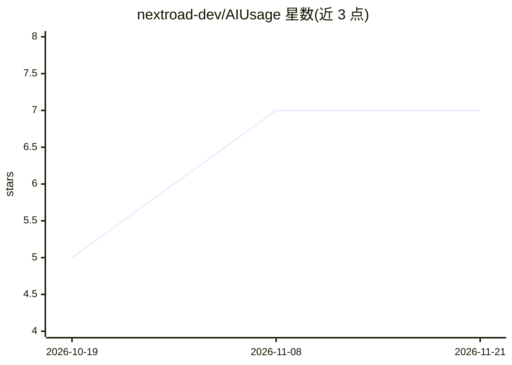

# nextroad-dev/AIUsage

⭐ — · [GitHub]() · 个人维护 · 中文 README

**让 AI 订阅用户在手机上一屏查看各家用量与剩余额度**

基于 Expo/React Native 的移动应用，聚合 ChatGPT/Codex、GitHub Copilot、OpenRouter、Cline 及多家国内外服务商的订阅用量：按 5 小时/每周/每月/余额等额度窗口显示已用与剩余、重置倒计时，并提供按消耗速度的用完时间估算、阈值本地通知、iOS 小组件与中转站（New API/Sub2API/One API）自动识别接入。无自建服务器，凭据存本机钥匙串。Android 提供预构建 APK，iOS 需自行签名安装未签名 IPA。

## 筛选速览

| 维度 | 判定 | 备注 |
|---|---|---|
| AI 角色 | `ai-ecosystem` | LLM/agent 周边工具 |
| 许可风险 | `none` | — |
| 部署形态 | `library` | 以包/库形式分发 |
| 模型依赖 | locked-api |  |
| 硬件要求 | — | 无带数字的原话,不猜 |
| 安装摩擦 | `low` | 无编译、无系统依赖或容器化 |
| 成熟度 | — | 结构信号不足 |

## 能力要点

- 一屏聚合多服务商额度窗口、重置倒计时与用完时间预测
- 中转站填地址和 Key 即自动识别站点类型与余额
- 用量阈值、额度恢复、套餐到期的本地通知提醒
- 无服务器架构：直接向各服务商请求用量，凭据存本机钥匙串

## 适用场景

- 同时订阅多家 AI 服务时统一查看剩余额度
- 估算本周期内会不会被限流、提前安排用量
- 用中转站管理多个 API Key 的余额

## 场景标签

 · 领域:AI 服务用量管理工具

## 证据(README 行号)

> L5:  一眼看清你的 AI 订阅还剩多少：用量、剩余额度、重置时间，全都在手机上。
> L47: |服务|连接方式|显示内容|
> L77: - **没有服务器**：应用直接向各服务商请求个人用量。全局重置模块直接读取 Codex Reset 的公开数据，不发送 ChatGPT Token、账户 ID 或个人用量。

## 星数曲线

2026-10-19 5 → 2026-11-21 7（+2）

---
*卡片 v1 · prompt 1.4 · 生成 2026-11-20 · 置信度 high · 依据 README sha `42c185423d64` · [字段定义](../../DATASET.md)*
