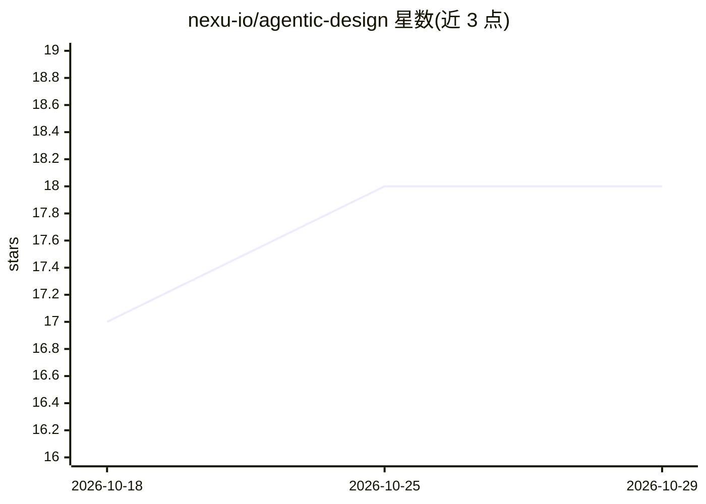

# nexu-io/agentic-design

⭐ 18 · MIT · 推送 2026-04-29 · [GitHub](https://github.com/nexu-io/agentic-design) · [官网](https://nexu.io) · 组织维护 · 中文 README

**nexu 的 agentic 设计工作空间：人与 AI Agent 在群聊中共同产出设计**

Open Design 是 nexu 推出的 chat-native、agent-native 产品设计工作空间仓库，定位为把 Figma/Jira/GitHub/Slack 等分散工具栈合并为一个群聊，产品经理、设计师、工程师与设计/PM/QA/增长类 Agent 在同一线程中共同产出 PRD、设计稿与原型。README 以产品愿景、用户调研（146 人）、四阶段路线图（2026–2027）与 nexu 生态说明为主，当前处于 pre-alpha，首个内部 alpha 计划 2026 年 5 月发布，暂不接受代码贡献。MIT 许可，采用 open core、编排与协作为托管服务的模式。

## 筛选速览

| 维度 | 判定 | 备注 |
|---|---|---|
| AI 角色 | `ai-native` | 本体是模型或模型工具 |
| 许可风险 | `permissive` | MIT |
| 部署形态 | `None` |  |
| 模型依赖 | — | README 未给出锁定关系 |
| 硬件要求 | — | 无带数字的原话,不猜 |
| 安装摩擦 | `low` | 无编译、无系统依赖或容器化 |
| 成熟度 | `idea` | |

## 能力要点

- 群聊即界面：PRD/设计/原型/发布说明等产物在同一线程流转
- 内置设计类 Agent（layout/component/copy/icon）与 PRD 转 Design 首稿
- 路线图覆盖桌面端本地优先、MCP 插件生态、人机同权协同编辑与一键部署上线
- nexu 家族成员，与 nexu 工作空间共享 OpenClaw agent 运行时

## 适用场景

- 在小团队中用一群 AI Agent 伴随完成从 PRD 到设计的迭代
- 把分散在 Figma/Jira/Slack 等工具的产品工作合并到单一线程
- 通过群聊 @ 设计/PM/QA Agent 分派并回收设计任务

## 场景标签

`多智能体` · 领域:Agent 开发

## 证据(README 行号)

> L15: **Open Design is a chat-native, agent-native workspace for the full product lifecycle — from PRD to pixel to produc
> L22: - 🤖 **Agents are teammates, not tools** — designer agents, PM agents, QA agents, growth agents all get @mentioned a

## 星数曲线

2026-10-18 17 → 2026-10-29 18（+1）

---
*卡片 v1 · prompt 1.4 · 生成 2026-10-29 · 置信度 mid · 依据 README sha `07ef2860630b` · [字段定义](../../DATASET.md)*
