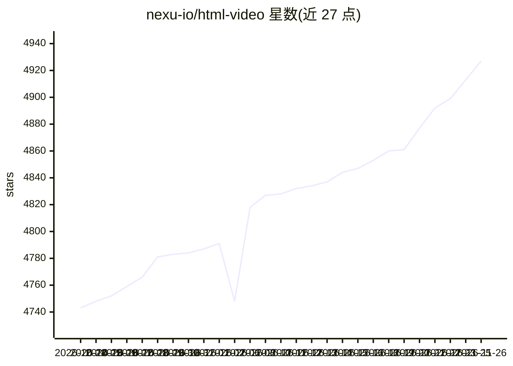

# nexu-io/html-video

⭐ 4,927 · HTML · Apache-2.0 · 推送 2026-11-17 · [GitHub](https://github.com/nexu-io/html-video) · [官网](https://open-design.ai/html-video) · 组织维护 · 中文 README

**给编码 agent 用的本地 HTML→MP4 程序化视频生成工具**

html-video 提供'元层'式的程序化视频生成管线：用户向本地编码 agent 描述视频或粘贴文章链接/GitHub 仓库，studio 在服务端抓取内容（支持微信公众号文章），agent 生成 content-graph 分镜并套用模板，Hyperframes 引擎用 headless Chromium 逐帧录制、ffmpeg（libx264）编码输出真实 MP4。支持 14 种编码 agent 自动检测切换、21 个带许可证溯源清单的模板、可选 MiniMax 配音配乐。Apache-2.0，无按次渲染收费。当前仅 Hyperframes 引擎可运行，Remotion 等在路线图中。

## 筛选速览

| 维度 | 判定 | 备注 |
|---|---|---|
| AI 角色 | `ai-ecosystem` | LLM/agent 周边工具 |
| 许可风险 | `permissive` | Apache-2.0 |
| 部署形态 | `library` | 以包/库形式分发 |
| 模型依赖 | locked-api |  |
| 硬件要求 | — | 无带数字的原话,不猜 |
| 安装摩擦 | `medium` | 含编译或系统依赖之一 |
| 成熟度 | `idea` | |

## 能力要点

- 14 种编码 agent 经 PATH 自动检测切换，或直接用 Anthropic Messages API
- Hyperframes 引擎本地渲染：Chromium 录帧 + ffmpeg/libx264 编码，无云端依赖
- 文章/仓库链接→content-graph 多场景分镜，支持微信公众号文章服务端抓取
- 21 个模板带 SPDX 许可证溯源清单，可商用

## 适用场景

- 把文章或开源项目链接生成为解读视频
- 为产品发布做 HTML 驱动的宣传短视频
- 给 agent 工作流添加程序化视频导出能力

## 场景标签

`编码 Agent` `视频生成` · 领域:编码与开发

## 证据(README 行号)

> L59: **html-video is the meta-layer that sits above all of them.** You talk to your agent; it picks the engine, picks th
> L69: |**Coding agents (14)**|Open Design (Vela) · Windsurf CLI · Trae CLI · Claude Code · Cursor Agent · Codex CLI · Gem

## 星数曲线

2026-10-24 4,743 → 2026-11-26 4,927（+184）

---
*卡片 v1 · prompt 1.4 · 生成 2026-11-22 · 置信度 mid · 依据 README sha `2b3b59008f26` · [字段定义](../../DATASET.md)*
