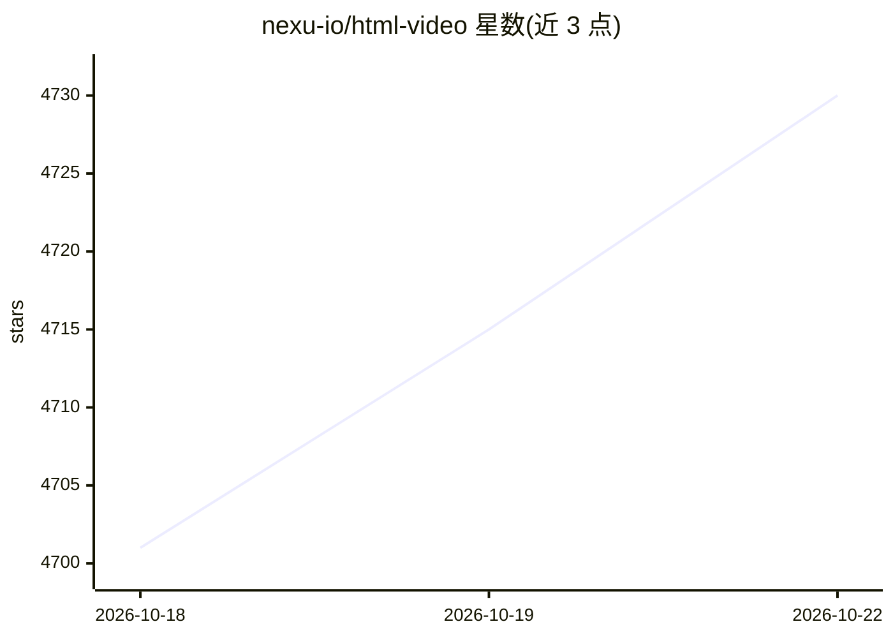

# nexu-io/html-video

⭐ 4,730 · HTML · Apache-2.0 · 推送 2026-06-21 · [GitHub](https://github.com/nexu-io/html-video) · [官网](https://open-design.ai/html-video) · 组织维护 · 中文 README

**让编程 Agent 把 HTML/文章/仓库生成本地渲染 MP4 的视频工具**

面向本地编程 Agent（支持 14 种 CLI 客户端，如 Claude Code、Codex CLI、Qwen Code，也可直接用 Anthropic API）的视频生成工作室与 CLI：输入一句话、文章链接或 GitHub 仓库，Agent 生成 content-graph 多帧分镜、填充内容，由可插拔渲染引擎输出真实 MP4。当前已接线的引擎为 Hyperframes：headless Chromium 逐帧录制 + ffmpeg（libx264）编码，全部本地渲染。提供 21 个经许可审查的模板与可选 MiniMax 配乐/旁白。Remotion、Motion Canvas 等引擎适配器尚未实现。

## 筛选速览

| 维度 | 判定 | 备注 |
|---|---|---|
| AI 角色 | `ai-native` | 本体是模型或模型工具 |
| 许可风险 | `permissive` | Apache-2.0 |
| 部署形态 | `library` | 以包/库形式分发 |
| 模型依赖 | locked-api |  |
| 硬件要求 | — | 无带数字的原话,不猜 |
| 安装摩擦 | `medium` | 含编译或系统依赖之一 |
| 成熟度 | `idea` | |

## 能力要点

- 14 种编程 Agent 客户端自动检测接入（ACP/stdin 等调用方式），支持 Anthropic API BYOK
- Hyperframes 引擎本地渲染：headless Chromium 录制 + ffmpeg 编码 MP4，无云端渲染与按次付费
- 文章链接/GitHub 仓库自动抓取内容并生成 content-graph 多帧分镜
- 21 个模板以 YAML manifest 描述，含 SPDX 许可与署名信息

## 适用场景

- 把一篇公众号文章或博客快速转成多场景解读视频
- 给开源项目仓库生成结构讲解视频
- 通过本地编程 Agent 用自然语言描述并产出品牌/数据可视化短片

## 场景标签

`视频生成` · 领域:内容生成

## 证据(README 行号)

> L69: |**Coding agents (14)**|Open Design (Vela) · Windsurf CLI · Trae CLI · Claude Code · Cursor Agent · Codex CLI · Gem
> L74: |**AI soundtrack**|Optional background music + narration via MiniMax, mixed into the MP4 at export.|

## 星数曲线

2026-10-18 4,701 → 2026-10-22 4,730（+29）

---
*卡片 v1 · prompt 1.4 · 生成 2026-10-20 · 置信度 mid · 依据 README sha `820de9b1ce8d` · [字段定义](../../DATASET.md)*
