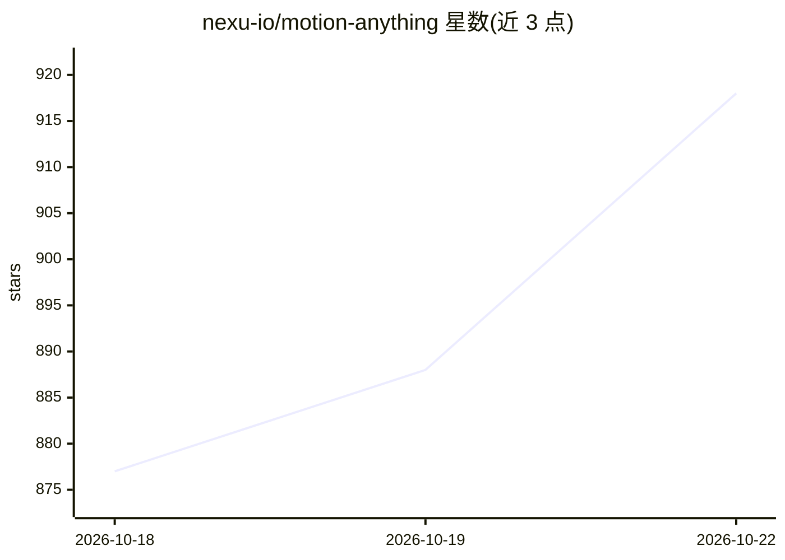

# nexu-io/motion-anything

⭐ 918 · JavaScript · Apache-2.0 · 推送 2026-07-07 · [GitHub](https://github.com/nexu-io/motion-anything) · 组织维护 · 中文 README

**本地优先的对话式动效引擎：一句话生成动画页面并逐组件编辑**

面向设计师与开发者的本地运动引擎：用一句话描述动效意图，由 8 种编码 agent CLI（Claude Code、Codex、Cursor、Gemini CLI 等）或 BYOK API key 驱动生成动画页面与发布视频；随后可在运行中的页面上逐组件编辑动效（触发器、预设、6 轨关键帧编辑器）。内置 403 个动效配方、230 个可移植 SKILL.md 技能，可导出 JSON/CSS/React/Lottie/MP4/GIF。零 npm 依赖，Apache-2.0，需要 Node 18+ 与至少一个 agent 引擎。

## 筛选速览

| 维度 | 判定 | 备注 |
|---|---|---|
| AI 角色 | `ai-native` | 本体是模型或模型工具 |
| 许可风险 | `permissive` | Apache-2.0 |
| 部署形态 | `library` | 以包/库形式分发 |
| 模型依赖 | locked-api |  |
| 硬件要求 | — | 无带数字的原话,不猜 |
| 安装摩擦 | `low` | 无编译、无系统依赖或容器化 |
| 成熟度 | — | 结构信号不足 |

## 能力要点

- 8 种编码 agent CLI 自动探测 + BYOK 直连 Anthropic/OpenAI/Google API
- 403 个动效配方，每个含 avoid_when 与 restraint 约束字段
- 逐组件在运行页面上编辑动效，6 轨关键帧编辑器
- 导出 JSON/CSS/React/Lottie/MP4/GIF 及可移植 SKILL.md

## 适用场景

- 一句话生成带品牌风格的动画落地页
- 在运行中的页面上逐组件微调动效而无需重写
- 制作并导出无水印的产品发布视频
- 把动效配方导出为技能供其他 agent 复用

## 场景标签

`代码生成` · 领域:编码与开发

## 证据(README 行号)

> L5: > **Describe the feeling — your AI ships the animation.** The agentic motion layer: a local-first, chat-native motio
> L105: Engines — 8 coding-agent CLIs plus BYOK
> L143: That is the whole install. **No npm install — the project has zero dependencies.** You need Node 18+ and at least 

## 星数曲线

2026-10-18 877 → 2026-10-22 918（+41）

---
*卡片 v1 · prompt 1.4 · 生成 2026-10-21 · 置信度 mid · 依据 README sha `8f871a280565` · [字段定义](../../DATASET.md)*
