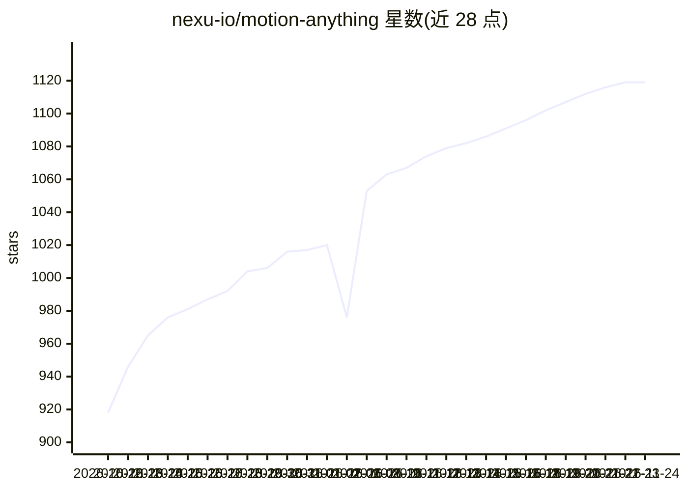

# nexu-io/motion-anything

⭐ 1,122 · JavaScript · Apache-2.0 · 推送 2026-11-17 · [GitHub](https://github.com/nexu-io/motion-anything) · 组织维护 · 中文 README

**对话式动效引擎：一句话让 AI 生成并逐组件编辑网页动画**

本地优先、聊天驱动的动效引擎：用户用一句话描述动效意图，由 8 个编码代理 CLI 或自有 API key（BYOK）生成动画页面与发布视频；在运行中的页面上逐组件编辑动效，支持 4 种触发器、13 种动效动词、spring 缓动与 6 轨关键帧编辑器。内置 403 条动效配方（含 intent_keywords、avoid_when、restraint 字段），可导出 JSON/CSS/React/Lottie/MP4/GIF/SKILL.md。零 npm 依赖，需 Node 18+ 与至少一个代理引擎。

## 筛选速览

| 维度 | 判定 | 备注 |
|---|---|---|
| AI 角色 | `ai-native` | 本体是模型或模型工具 |
| 许可风险 | `permissive` | Apache-2.0 |
| 部署形态 | `library` | 以包/库形式分发 |
| 模型依赖 | locked-api |  |
| 硬件要求 | — | 无带数字的原话,不猜 |
| 安装摩擦 | `low` | 无编译、无系统依赖或容器化 |
| 成熟度 | — | 结构信号不足 |

## 能力要点

- 在运行页面逐组件编辑动效并回写文件
- 8 个编码代理 CLI 自动检测 + BYOK 直连 API，密钥不出本机
- 403 条配方带 avoid_when 与 restraint 预算，尊重 prefers-reduced-motion
- 导出 JSON/CSS/React/Lottie/MP4/GIF 及可移植 SKILL.md

## 适用场景

- 一句话生成带动效的落地页
- 在页面上给某个组件添加悬停/点击动效
- 用浏览器内 WebCodecs 导出无水印发布视频
- 把动效配方导出为技能供其他代理复用

## 场景标签

`代码生成` `视频生成` · 领域:编码与开发

## 证据(README 行号)

> L5: > **Describe the feeling — your AI ships the animation.** The agentic motion layer: a local-first, chat-native motio
> L105: Engines — 8 coding-agent CLIs plus BYOK
> L145: That is the whole install. **No npm install — the project has zero dependencies.** You need Node 18+ and at least 

## 星数曲线

2026-10-22 918 → 2026-11-24 1,119（+201）

---
*卡片 v1 · prompt 1.4 · 生成 2026-11-24 · 置信度 mid · 依据 README sha `d603e9e7c5ba` · [字段定义](../../DATASET.md)*
