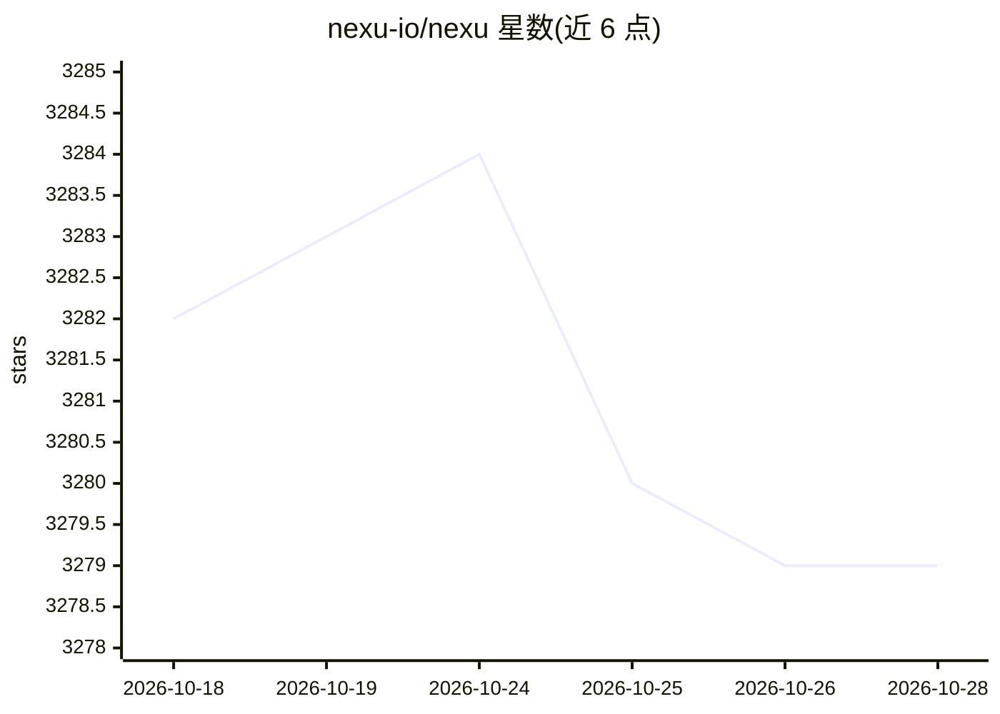

# nexu-io/nexu

⭐ 3,279 · TypeScript · MIT · 推送 2026-04-26 · [GitHub](https://github.com/nexu-io/nexu) · [官网](https://nexu.io) · 组织维护 · 中文 README

**把 OpenClaw Agent 接入微信/飞书/Slack/Discord 的桌面客户端**

开源（MIT）桌面客户端，将 OpenClaw Agent 连接到微信、飞书、Slack、Discord 等 IM 渠道，连接后 Agent 24/7 在线、可从手机对话。提供图形化安装（macOS Apple Silicon/Intel、Windows 10+ 双击安装包），内置 OpenClaw Skills 与飞书 Skills，支持多模型：nexu 账户直接使用 Gemini 等，或自带 API Key 免登录；MiniMax、OpenAI Codex、GLM 支持 OAuth 登录。数据本地存储。面向个人公司与小团队；开发需 Node.js 22+ 与 pnpm 10+。

## 筛选速览

| 维度 | 判定 | 备注 |
|---|---|---|
| AI 角色 | `ai-ecosystem` | LLM/agent 周边工具 |
| 许可风险 | `permissive` | MIT |
| 部署形态 | `None` |  |
| 模型依赖 | — | README 未给出锁定关系 |
| 硬件要求 | — | 无带数字的原话,不猜 |
| 安装摩擦 | `low` | 无编译、无系统依赖或容器化 |
| 成熟度 | — | 结构信号不足 |

## 能力要点

- 一键扫码将 OpenClaw Agent 接入微信/飞书/Slack/Discord，手机端可对话
- BYOK 免登录使用，MiniMax/Codex/GLM 支持 OAuth 授权
- 内置 OpenClaw Skills 与完整飞书 Skills
- macOS/Windows 桌面安装包，数据保留在本机

## 适用场景

- 让我的 AI Agent 在微信/飞书里 24/7 在线，随时手机提问
- 一人公司用 Agent 处理商品上架、内容创作、合同审阅等事务
- 用自有 API Key 运行模型而不经过第三方托管服务器

## 场景标签

`AI 助手` · 领域:对话与助手

## 证据(README 行号)

> L25: **nexu** (next to you) is an open-source desktop client that runs your **OpenClaw 🦞** Agent directly inside WeChat,
> L27: WeChat + OpenClaw supported — works with WeChat 8.0.7 OpenClaw plugin. Click connect, scan with WeChat, and start c

## 星数曲线

2026-10-18 3,282 → 2026-10-28 3,279（-3）

---
*卡片 v1 · prompt 1.4 · 生成 2026-10-20 · 置信度 high · 依据 README sha `88240369af2e` · [字段定义](../../DATASET.md)*
