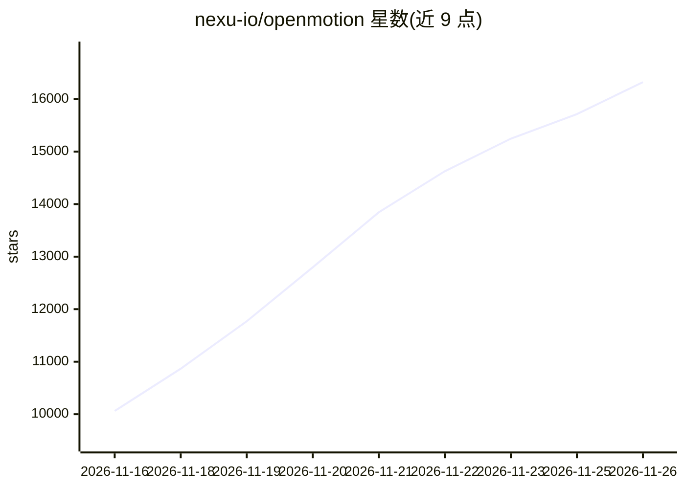

# nexu-io/openmotion

⭐ 16,322 · TypeScript · Apache-2.0 · 推送 2026-11-25 · [GitHub](https://github.com/nexu-io/openmotion) · [官网](https://open-design.ai/motion/) · 组织维护 · 中文 README

**开源动效视频工作室：用 agent 将参考视频重制为可编辑品牌视频**

全栈 agentic 视频工作室，自称 Claude Motion 与 CapCut 的开源替代。用户上传参考视频或贴社交视频链接，agent 将其拆解为 Motion.md（记录镜头顺序、时序、转场的 Markdown 格式），再用品牌素材重建 HTML 场景，在 Studio 时间线编辑并渲染 MP4。BYOA/BYOK 模式：默认通过 Skills CLI 安装 Skill 并经 OAuth 2.1 连接托管 Cloud MCP，亦可本地源码运行仓库；支持 22 个本地 agent。内置模型集成可生成图像、视频、音乐与 TTS 旁白。

## 筛选速览

| 维度 | 判定 | 备注 |
|---|---|---|
| AI 角色 | `ai-native` | 本体是模型或模型工具 |
| 许可风险 | `permissive` | Apache-2.0 |
| 部署形态 | `library` | 以包/库形式分发 |
| 模型依赖 | — | README 未给出锁定关系 |
| 硬件要求 | — | 无带数字的原话,不猜 |
| 安装摩擦 | `medium` | 含编译或系统依赖之一 |
| 成熟度 | — | 结构信号不足 |

## 能力要点

- Motion.md Markdown 格式记录镜头顺序、时序与转场
- 支持 22 个本地 agent（Claude Code、Codex CLI、Gemini CLI 等）
- 内置模型集成生成图像、视频、音乐与语音旁白
- 同一项目在 Studio 编辑并渲染 MP4，保留 HTML/CSS/JS 源码

## 适用场景

- 把参考视频用自己品牌 kit 与文案重制为短视频
- 为 YouTube、Shorts、Reels、TikTok 制作动效内容
- 在对话中让 agent 剪辑、改词、调整时序并导出 MP4

## 场景标签

`视频生成` · 领域:内容生成

## 证据(README 行号)

> L26: OpenMotion is a **full-stack agentic video** studio and an **open-source alternative to Claude Motion and CapCut**.
> L29: - 🔑 **BYOA — Bring Your Own Agent. BYOK — Bring Your Own Keys.** OpenMotion is free and open source. Recreate video
> L228: **Code video with HTML.** OpenMotion uses HTML, CSS and JavaScript to describe scenes, typography, layout, transit

## 星数曲线

2026-11-16 10,063 → 2026-11-26 16,322（+6,259）

---
*卡片 v1 · prompt 1.4 · 生成 2026-11-26 · 置信度 high · 依据 README sha `a1dbf09e0da6` · [字段定义](../../DATASET.md)*
