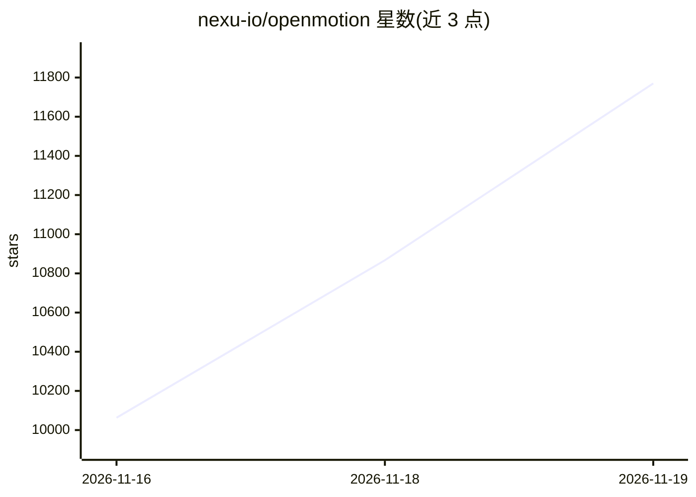

# nexu-io/openmotion

⭐ 11,770 · TypeScript · Apache-2.0 · 推送 2026-11-18 · [GitHub](https://github.com/nexu-io/openmotion) · [官网](https://open-design.ai/motion/) · 组织维护 · 中文 README

**开源 AI 视频工作台：把参考视频重制成可编辑的品牌动效视频**

全栈 agentic 视频工作室：上传参考视频或贴入社媒链接，由用户自带的本体 agent（支持 Claude Code、Codex、WorkBuddy 等 22 种）拆解镜头、用 HTML/CSS/JS 重建场景与转场，并通过内置模型集成生成图片、视频、音乐与 TTS 配音；用户在 Studio 中调整时间线并渲染 MP4。采用 BYOA/BYOK 模式，免费开源（Apache 2.0），需 Node.js 22.18+，可从 ChatGPT Marketplace 一键安装或从源码运行，另提供可选的 npm 发布版与 OpenDesign 订阅服务。

## 筛选速览

| 维度 | 判定 | 备注 |
|---|---|---|
| AI 角色 | `ai-native` | 本体是模型或模型工具 |
| 许可风险 | `permissive` | Apache-2.0 |
| 部署形态 | `library` | 以包/库形式分发 |
| 模型依赖 | — | README 未给出锁定关系 |
| 硬件要求 | — | 无带数字的原话,不猜 |
| 安装摩擦 | `medium` | 含编译或系统依赖之一 |
| 成熟度 | — | 结构信号不足 |

## 能力要点

- 参考视频拆解为 Motion.md 记录镜头顺序/时序/转场，agent 按品牌套件重建 HTML 场景
- 支持 22 种本地 agent，BYOA/BYOK，本地 MCP 客户端与 shell 工作流
- 内置图片/视频/音乐/TTS 模型集成，Studio 中编辑时间线并渲染 MP4
- 提供 300+ Motion.md 指南与模板库，可导入 HyperFrames 项目 ZIP

## 适用场景

- 把爆款短视频改成自己品牌风格的品牌片或产品发布视频
- 制作带字幕、屏幕插入与动效关键词的 AI 口播视频
- 为 YouTube Shorts、Reels、TikTok 导出 MP4 短视频

## 场景标签

`视频生成` `语音合成` `图像生成` · 领域:内容生成

## 证据(README 行号)

> L26: OpenMotion is a **full-stack agentic video** studio and an **open-source alternative to Claude Motion and CapCut**.
> L29: - 🔑 **BYOA — Bring Your Own Agent. BYOK — Bring Your Own Keys.** OpenMotion is free and open source. Recreate video
> L222: Your local agent, optional media-model accounts and creative resources feed a workflow of understanding the refere

## 星数曲线

2026-11-16 10,063 → 2026-11-19 11,770（+1,707）

---
*卡片 v1 · prompt 1.4 · 生成 2026-11-17 · 置信度 high · 依据 README sha `9485c43ca0f4` · [字段定义](../../DATASET.md)*
