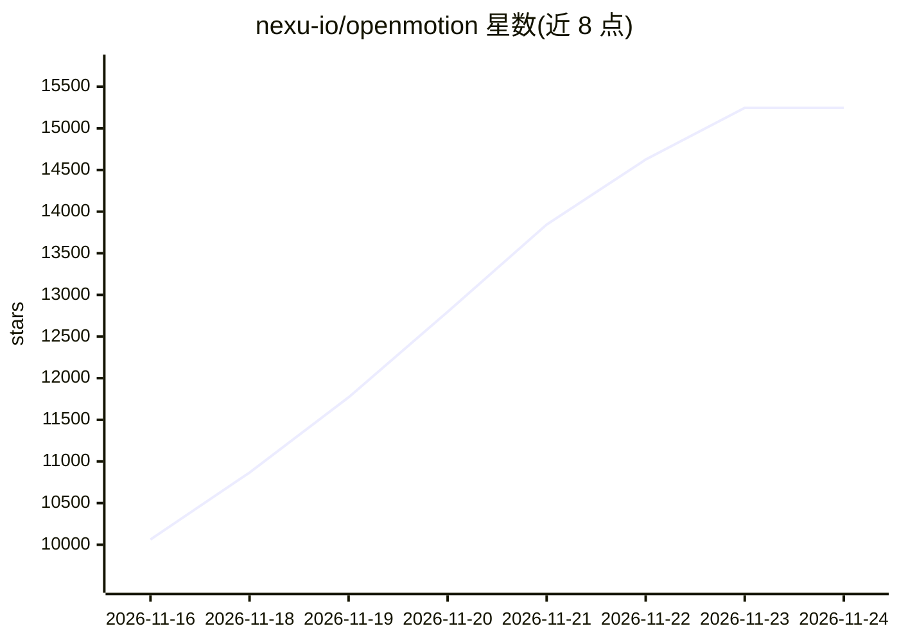

# nexu-io/openmotion

⭐ 15,713 · TypeScript · Apache-2.0 · 推送 2026-11-24 · [GitHub](https://github.com/nexu-io/openmotion) · [官网](https://open-design.ai/motion/) · 组织维护 · 中文 README

**开源的 agentic 视频工作室：把参考视频重做成带品牌素材的可编辑动效视频**

OpenMotion 是全栈 agentic 视频工作室，定位为 Claude Motion 与 CapCut 的开源替代。用户上传参考视频或粘贴社交视频链接，由本地 agent 拆解镜头与转场，用 HTML/CSS/JavaScript 重建为可编辑项目，并通过内置模型集成生成缺失的图像、视频片段、音乐与 TTS 旁白，最后在 Studio 时间线编辑并渲染 MP4。引入 Motion.md Markdown 格式描述镜头顺序、时序与转场以便分享。采用 BYOA/BYOK：免费开源，使用用户自己的 agent 与 API key，支持 22 个本地 agent。需 Node.js，发布渠道含 ChatGPT Marketplace、Skills CLI、npm 包与源码构建。

## 筛选速览

| 维度 | 判定 | 备注 |
|---|---|---|
| AI 角色 | `ai-native` | 本体是模型或模型工具 |
| 许可风险 | `permissive` | Apache-2.0 |
| 部署形态 | `library` | 以包/库形式分发 |
| 模型依赖 | — | README 未给出锁定关系 |
| 硬件要求 | — | 无带数字的原话,不猜 |
| 安装摩擦 | `medium` | 含编译或系统依赖之一 |
| 成熟度 | — | 结构信号不足 |

## 能力要点

- 参考视频拆解为 Motion.md，agent 用 HTML 代码重建镜头与转场
- BYOA/BYOK：接入 22 个本地 agent（Claude Code、Codex、Gemini CLI 等）
- 内置图像、视频、音乐与 TTS 模型集成（GPT Image、Seedance、Suno、Eleven v4）
- Studio 可视化时间线编辑并渲染 MP4，保留 HTML/CSS/JS 源码

## 适用场景

- 把竞品或参考视频重做成自己品牌风格的产品宣传片
- 批量制作 YouTube Shorts、Reels、TikTok 竖屏短视频
- 制作带图表与字幕的讲解教程视频
- 导出完整源码项目，迭代修改后重新渲染

## 场景标签

`视频生成` `语音合成` · 领域:内容生成

## 证据(README 行号)

> L26: OpenMotion is a **full-stack agentic video** studio and an **open-source alternative to Claude Motion and CapCut**.
> L29: - 🔑 **BYOA — Bring Your Own Agent. BYOK — Bring Your Own Keys.** OpenMotion is free and open source. Recreate video

## 星数曲线

2026-11-16 10,063 → 2026-11-24 15,246（+5,183）

---
*卡片 v1 · prompt 1.4 · 生成 2026-11-22 · 置信度 high · 依据 README sha `53a11bea8000` · [字段定义](../../DATASET.md)*
