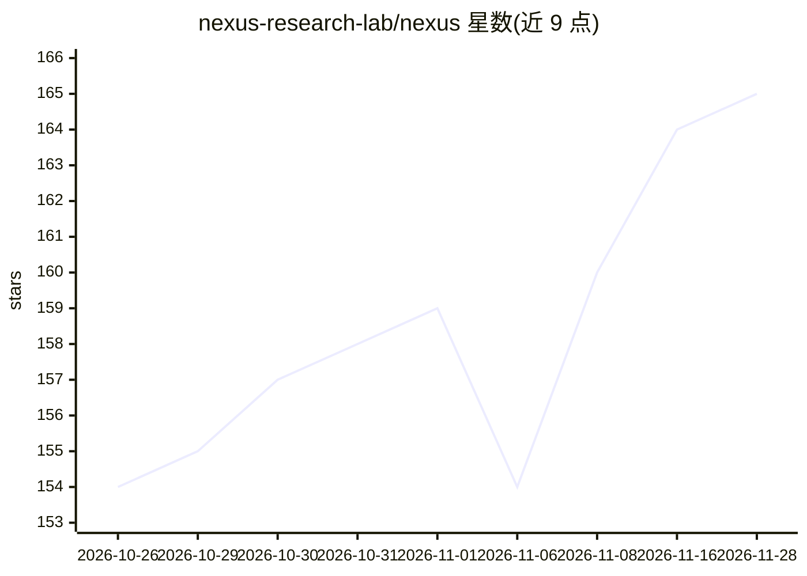

# nexus-research-lab/nexus

⭐ 165 · Go · Apache-2.0 · 推送 2026-11-27 · [GitHub](https://github.com/nexus-research-lab/nexus) · [官网](https://www.nexusos.cn) · 组织维护 · 中文 README

**面向企业/科研团队的多 Agent 协作平台**

Go/Node.js 实现的多 Agent 协作平台：每个 Agent 拥有独立身份、工作区与运行时管理的文件式记忆（MEMORY.md 索引与主题文件），房间支持多 Agent 围绕任务讨论分工，DM 支持单人聚焦协作；提供 Echo 跟进、定时任务与环境感知等主动执行机制。内置 Skills 可读写 Word/PDF/PowerPoint/Excel，Connectors 集成飞书、钉钉多维表、腾讯文档、语雀及自定义 MCP 服务。默认捆绑闭源 nxs 运行时，也可切换 claude 后端经 Claude Code 运行 Agent；支持桌面应用与 Docker/源码部署。

## 筛选速览

| 维度 | 判定 | 备注 |
|---|---|---|
| AI 角色 | `ai-ecosystem` | LLM/agent 周边工具 |
| 许可风险 | `permissive` | Apache-2.0 |
| 部署形态 | `desktop` | 安装包/桌面程序 |
| 模型依赖 | locked-api |  |
| 硬件要求 | — | 无带数字的原话,不猜 |
| 安装摩擦 | `low` | 无编译、无系统依赖或容器化 |
| 成熟度 | — | 结构信号不足 |

## 能力要点

- 多 Agent 房间协作：@提及、定向回复、多线程进度
- 文件式持久记忆：MEMORY.md 索引与主题文件跨会话延续
- 双运行时后端：捆绑 nxs（默认）或经 Claude Code 运行 claude 后端
- Skills 支持 Office 文件读写，Connectors 接入飞书/钉钉/腾讯文档/语雀/MCP

## 适用场景

- 组织多个 Agent 在同一房间分工完成复杂任务
- 为团队搭建带持久记忆与外部服务连接的 Agent 工作区
- 通过定时任务与环境感知让 Agent 主动推进工作
- 私有化部署企业内部 Agent 协作平台

## 场景标签

`多智能体` `Agent 记忆` · 领域:Agent 开发

## 证据(README 行号)

> L13: Nexus is a multi-agent collaboration platform for enterprises, research teams, and developers. Agents can be named 
> L22: Nexus brings agent management, task collaboration, and external service connections into one unified platform for a
> L45: Nexus supports two Agent runtime backends: `nxs` and `claude`. Official Nexus

## 星数曲线

2026-10-26 154 → 2026-11-28 165（+11）

---
*卡片 v1 · prompt 1.4 · 生成 2026-11-27 · 置信度 mid · 依据 README sha `aec51aab49f3` · [字段定义](../../DATASET.md)*
