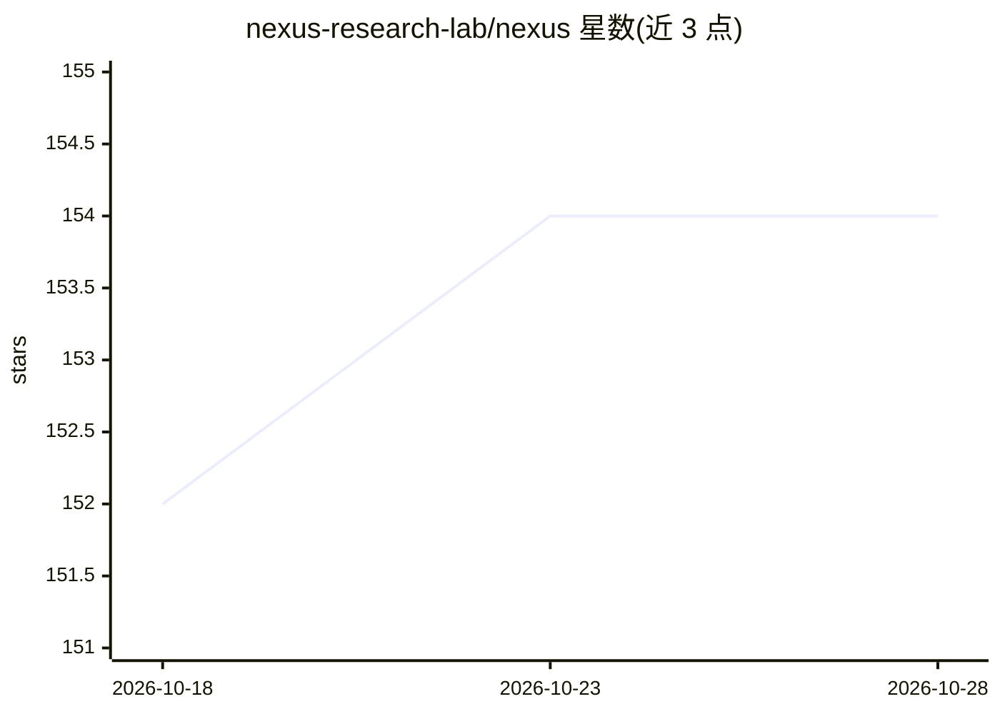

# nexus-research-lab/nexus

⭐ 155 · Go · Apache-2.0 · 推送 2026-10-27 · [GitHub](https://github.com/nexus-research-lab/nexus) · [官网](https://www.nexusos.cn) · 组织维护 · 中文 README

**企业/团队的多 Agent 协作平台：持久记忆的 Agent 房间协作**

面向企业、科研团队与开发者的多 Agent 协作平台：Agent 具有独立身份、专属工作区与运行时管理的文件式记忆（MEMORY.md 与主题文件），可在 Room 中多人多 Agent 协作分工，DM 支持单 Agent 对话；支持 Echo 跟进、定时任务等主动执行机制。内置 Skills 处理 Word/PDF/PPT/Excel 文件，Connector 接入飞书文档、钉钉 AI 表格、腾讯文档、语雀及自定义 MCP 服务。Agent 运行时后端为 nxs（默认，闭源可执行文件，不在本仓库）或 Claude Code；提供 Web UI、Docker/源码部署与 macOS/Windows 桌面应用。

## 筛选速览

| 维度 | 判定 | 备注 |
|---|---|---|
| AI 角色 | `ai-native` | 本体是模型或模型工具 |
| 许可风险 | `permissive` | Apache-2.0 |
| 部署形态 | `desktop` | 安装包/桌面程序 |
| 模型依赖 | locked-api |  |
| 硬件要求 | — | 无带数字的原话,不猜 |
| 安装摩擦 | `low` | 无编译、无系统依赖或容器化 |
| 成熟度 | — | 结构信号不足 |

## 能力要点

- Agent 拥有独立工作区与跨会话持久文件记忆（MEMORY.md 索引）
- Room 多 Agent 协作（@提及、定向回复、多线程）与 Echo 跟进等主动执行
- Skills 读写渲染 Word/PDF/PowerPoint/Excel；Connector 接入飞书/钉钉/腾讯文档/语雀/MCP
- 双运行时后端：默认 nxs（闭源子进程，可替换）或 Claude Code

## 适用场景

- 团队在房间式空间中让多个 Agent 分工协作完成复杂任务
- 跨会话保持 Agent 的任务上下文与知识积累
- 让 Agent 处理办公文档并对接飞书/钉钉/腾讯文档等企业服务

## 场景标签

`多智能体` `Agent 记忆` · 领域:Agent 开发

## 证据(README 行号)

> L13: Nexus is a multi-agent collaboration platform for enterprises, research teams, and developers. Agents can be named 
> L19: - Proactive execution: Echo follow-ups, scheduled tasks, and environment awareness help agents move work forward
> L45: Nexus supports two Agent runtime backends: `nxs` and `claude`. Official Nexus

## 星数曲线

2026-10-18 152 → 2026-10-28 154（+2）

---
*卡片 v1 · prompt 1.4 · 生成 2026-10-23 · 置信度 mid · 依据 README sha `835b344b59a8` · [字段定义](../../DATASET.md)*
