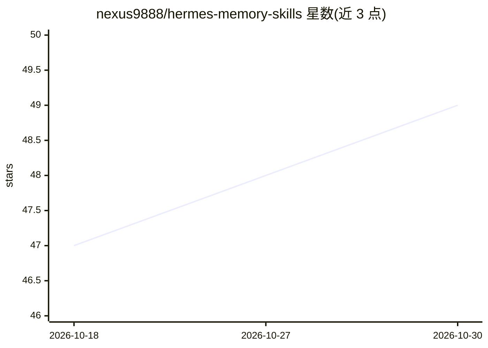

# nexus9888/hermes-memory-skills

⭐ 49 · 推送 2026-06-03 · [GitHub](https://github.com/nexus9888/hermes-memory-skills) · 个人维护

**Hermes Agent 的记忆维护技能：跨后端的记忆整理与净化**

面向 Hermes Agent 的记忆卫生（memory hygiene）技能集，核心为 agent-dreaming：三阶段后台记忆整理（Light/Deep/REM）加 Phase 2.5 凝聚，自动检测当前记忆后端（内置 MEMORY.md 或 Holographic SQLite 向量库），在 Phase 2 将写入操作路由到对应工具集；Honcho/Mem0 等其他后端回退到内置路径。已知限制：Hermes 的 cron 调度器强制 skip_memory，定时任务中无法调用记忆工具，提升操作降级为直接修改 MEMORY.md，需依赖手动运行或提高 cron 频率等变通方案。通过 hermes skills 命令或 git clone 安装。

## 筛选速览

| 维度 | 判定 | 备注 |
|---|---|---|
| AI 角色 | `ai-ecosystem` | LLM/agent 周边工具 |
| 许可风险 | `none` | — |
| 部署形态 | `None` |  |
| 模型依赖 | — | README 未给出锁定关系 |
| 硬件要求 | — | 无带数字的原话,不猜 |
| 安装摩擦 | `low` | 无编译、无系统依赖或容器化 |
| 成熟度 | — | 结构信号不足 |

## 能力要点

- 运行时检测记忆后端并自动路由（memory() 或 fact_store/fact_feedback）
- 三阶段记忆整理（Light/Deep/REM）+ 内置 Phase 2.5 凝聚
- holographic 后端使用信任分数（0.0–1.0）做衰减与膨胀处理
- cron 场景下因 Hermes 核心限制降级为 MEMORY.md 文件修补

## 适用场景

- 让长期运行的 Hermes Agent 定期整理和净化记忆
- 内置 MEMORY.md 接近容量上限时做凝聚与去冗余
- 使用 Holographic 后端时按信任分数衰减过期事实

## 场景标签

`Agent 记忆` · 领域:Agent 开发

## 证据(README 行号)

> L1: # Hermes Agent Memory Skills (Memory-Agnostic)
> L11: Rather than making users choose between backends OR skills, these skills detect the active backend at runtime and a

## 星数曲线

2026-10-18 47 → 2026-10-30 49（+2）

---
*卡片 v1 · prompt 1.4 · 生成 2026-10-25 · 置信度 high · 依据 README sha `476c66bd35c0` · [字段定义](../../DATASET.md)*
