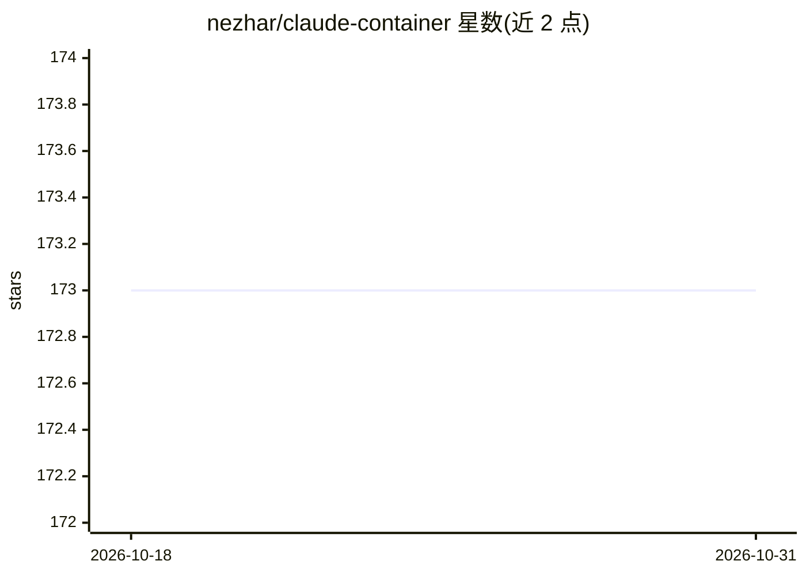

# nezhar/claude-container

⭐ 173 · Shell · MIT · 推送 2026-03-05 · [GitHub](https://github.com/nezhar/claude-container) · [官网](https://github.com/VibePod/vibepod-cli) · 个人维护

**在 Docker 隔离环境中运行 Claude Code 的容器套件**

提供预装 Claude Code CLI 的 Docker 镜像（Node.js 22 Alpine 基础），配 bash 助手脚本、Docker Compose 与 docker run 三种运行方式，首次登录后凭据持久化于 bind mount。另含两个可选镜像：HTTP 代理把 Claude Code 发往 Anthropic API 的请求/响应记录到 SQLite，Datasette 容器提供 Web 界面浏览、过滤、SQL 查询与导出日志。镜像版本与 Claude Code 版本以兼容矩阵对应（如 1.6.x 对应 2.1.x）。

## 筛选速览

| 维度 | 判定 | 备注 |
|---|---|---|
| AI 角色 | `ai-ecosystem` | LLM/agent 周边工具 |
| 许可风险 | `permissive` | MIT |
| 部署形态 | `self-host` | docker 或自建部署 |
| 模型依赖 | locked-api |  |
| 硬件要求 | — | 无带数字的原话,不猜 |
| 安装摩擦 | `low` | 无编译、无系统依赖或容器化 |
| 成熟度 | — | 结构信号不足 |

## 能力要点

- 三个 Docker 镜像：claude-container / claude-proxy / claude-datasette
- 代理将全部 Anthropic API 请求响应记录至 SQLite
- Datasette Web UI 支持过滤、SQL 查询与 CSV/JSON/Excel 导出
- 凭据经 bind mount 持久化，首次登录后复用

## 适用场景

- 在隔离容器中运行 Claude Code，避免污染本机环境
- 记录并分析 Claude Code 的 API 请求、token 用量与成本
- 将 Claude Code 作为 Compose profile 集成进现有项目

## 场景标签

`编码 Agent` `LLM 可观测性` · 领域:编码与开发

## 证据(README 行号)

> L3: A Docker container with Claude Code pre-installed and ready to use.
> L7: An optional proxy can be enabled to track all the requests made by Claude Code in a local SQLite database.
> L163: This repository includes an optional logging proxy that captures all Anthropic API requests and responses to a SQL

## 星数曲线

2026-10-18 173 → 2026-10-31 173（+0）

---
*卡片 v1 · prompt 1.4 · 生成 2026-10-23 · 置信度 high · 依据 README sha `1880f9fb931d` · [字段定义](../../DATASET.md)*
