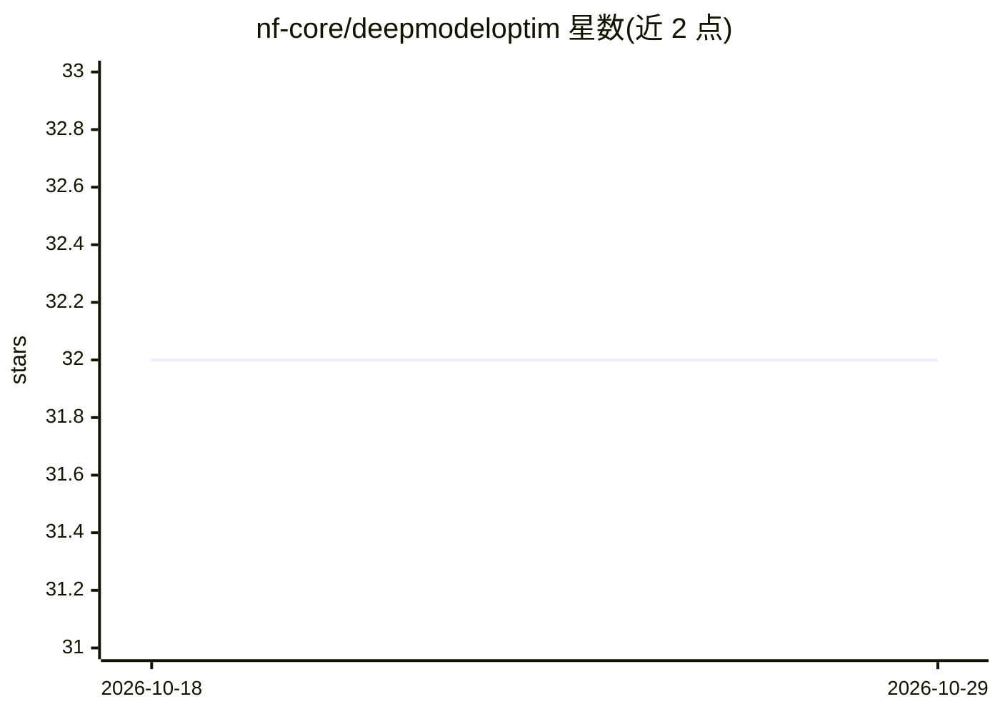

# nf-core/deepmodeloptim

⭐ 32 · Nextflow · MIT · 推送 2026-10-26 · [GitHub](https://github.com/nf-core/deepmodeloptim) · [官网](https://nf-co.re/deepmodeloptim) · 组织维护

**面向生物数据的深度学习训练集优化 Nextflow 流水线**

nf-core 社区维护的生物信息流水线（原名 STIMULUS 思路）：以 CSV 样本表（name:type:class 格式，支持 dna 等 class）与用户提供的 PyTorch 模型 .py 文件为输入，通过随机测试与输入数据操纵对数据进行增强/变换，配合 experiment_config（JSON）定义实验设计，寻找面向特定任务的最优训练集与模型参数。以 nextflow run 方式运行，支持 docker/singularity/conda 等执行配置。README 显示 experiment_config 计划迁移到 .yaml，该部分格式可能变动。

## 筛选速览

| 维度 | 判定 | 备注 |
|---|---|---|
| AI 角色 | `ai-ecosystem` | LLM/agent 周边工具 |
| 许可风险 | `permissive` | MIT |
| 部署形态 | `None` |  |
| 模型依赖 | — | README 未给出锁定关系 |
| 硬件要求 | — | 无带数字的原话,不猜 |
| 安装摩擦 | `low` | 无编译、无系统依赖或容器化 |
| 成熟度 | `idea` | |

## 能力要点

- CSV 样本表定义 input/meta/label 三类数据列
- 用户提交 PyTorch 模型文件参与流水线训练与参数搜索
- JSON 格式 experiment_config 控制数据调优实验设计
- 基于 Nextflow，支持 docker/singularity/conda 多种运行配置

## 适用场景

- 为生物数据的深度学习任务构造增强训练集
- 在可复现流水线中做模型参数搜索与实验设计
- 整合进 nf-core 生态进行大规模基因组学建模实验

## 场景标签

`模型训练` · 领域:训练与推理

## 证据(README 行号)

> L19: **nf-core/deepmodeloptim** augments your bio data towards an optimal task-specific training set.
> L80: In STIMULUS, users input a .py file containing a model written in pytorch (see examples in bin/tests/models)
> L122: ### Model parameter search design

## 星数曲线

2026-10-18 32 → 2026-10-29 32（+0）

---
*卡片 v1 · prompt 1.4 · 生成 2026-10-25 · 置信度 mid · 依据 README sha `0ce28b3c39b1` · [字段定义](../../DATASET.md)*
