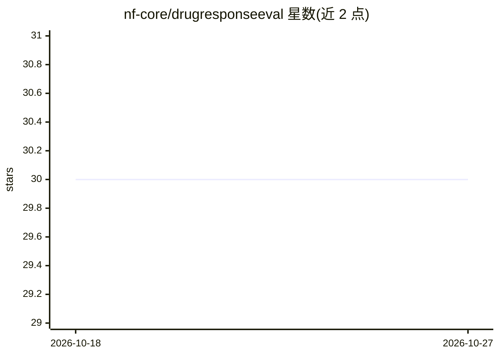

# nf-core/drugresponseeval

⭐ 30 · Nextflow · MIT · 推送 2026-10-26 · [GitHub](https://github.com/nf-core/drugresponseeval) · [官网](https://nf-co.re/drugresponseeval) · 组织维护

**药物响应预测模型的标准化评测框架（Nextflow 流程）**

DrEval 由 PyPI 包 drevalpy 与本仓库的 Nextflow 流水线组成，用于对药物响应预测模型做统计与生物学上可复现的评测：自动加载数据集（CTRP/GDSC/CCLE/BeatAML 等），在交叉验证中训练与评估各模型，按网格搜索选超参，支持随机化与稳健性检验，并生成汇总图表与排行榜（Nemenyi 检验的临界差异图）。模型接口灵活，统计模型到神经网络均可接入，研究者可将自有模型纳入目录对比。面向生物信息学研究者运行。

## 筛选速览

| 维度 | 判定 | 备注 |
|---|---|---|
| AI 角色 | `ai-ecosystem` | LLM/agent 周边工具 |
| 许可风险 | `permissive` | MIT |
| 部署形态 | `library` | 以包/库形式分发 |
| 模型依赖 | — | README 未给出锁定关系 |
| 硬件要求 | — | 无带数字的原话,不猜 |
| 安装摩擦 | `low` | 无编译、无系统依赖或容器化 |
| 成熟度 | — | 结构信号不足 |

## 能力要点

- 交叉验证 + 网格搜索超参的标准化评测协议
- 支持随机化测试与 N 次重复的稳健性测试
- 内置排行榜与 Nemenyi 检验的临界差异图
- 灵活模型接口，支持统计模型到神经网络，可接入自有模型

## 适用场景

- 我把自己的药物响应预测模型接入标准化评测与其他模型对比
- 在多个公开数据集上复现统一的交叉验证与超参调优
- 查看模型排行榜了解各方法的相对表现

## 场景标签

`模型评测` · 领域:评测与运维

## 证据(README 行号)

> L24: **DrEval** is a bioinformatics framework that includes a PyPI package (drevalpy) and a Nextflow
> L26: meaningful, and reproducible. DrEval simplifies the implementation of drug response prediction
> L28: standardized evaluation protocols and preprocessing workflows. With DrEval, hyperparameter

## 星数曲线

2026-10-18 30 → 2026-10-27 30（+0）

---
*卡片 v1 · prompt 1.4 · 生成 2026-10-26 · 置信度 mid · 依据 README sha `c08b7808c936` · [字段定义](../../DATASET.md)*
