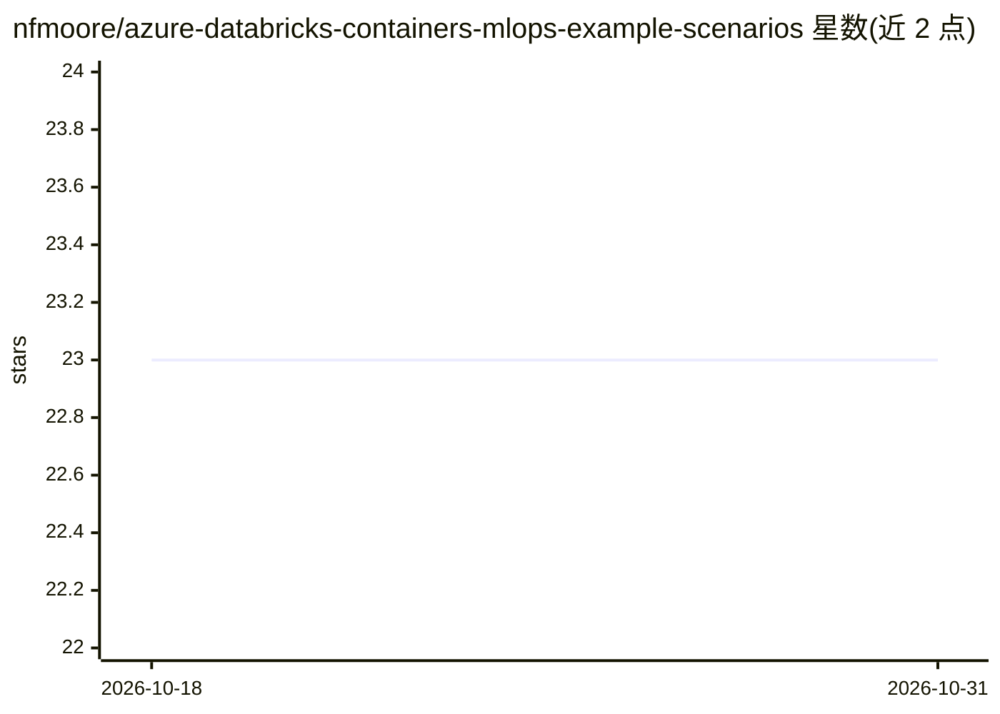

# nfmoore/azure-databricks-containers-mlops-example-scenarios

⭐ 23 · Jupyter Notebook · MIT · 推送 2026-02-02 · [GitHub](https://github.com/nfmoore/azure-databricks-containers-mlops-example-scenarios) · 个人维护

**Azure Databricks 容器化 MLOps 在线推理示例场景指南**

提供在 Azure Databricks 上构建、部署与监控机器学习模型的规范性指南：模型在 Databricks 上训练，经容器化后部署为 Web 服务，部署目标为 Azure Container Apps 或 Azure Kubernetes Service，并配合自动化工作流（如 GitHub Actions 主题标签所示）进行构建部署与监控（用量、性能、数据漂移）。示例聚焦经典机器学习问题，使用改编版 UCI 信用卡客户违约数据集。面向需要在 Azure 环境实践 MLOps 的 ML 团队与工程师，属概念验证性质的示例仓库。

## 筛选速览

| 维度 | 判定 | 备注 |
|---|---|---|
| AI 角色 | `ai-ecosystem` | LLM/agent 周边工具 |
| 许可风险 | `permissive` | MIT |
| 部署形态 | `None` |  |
| 模型依赖 | — | README 未给出锁定关系 |
| 硬件要求 | — | 无带数字的原话,不猜 |
| 安装摩擦 | `low` | 无编译、无系统依赖或容器化 |
| 成熟度 | — | 结构信号不足 |

## 能力要点

- 覆盖 Azure Databricks 模型构建到容器化部署全流程
- 提供 Azure Container Apps 与 AKS 两种部署场景
- 包含模型用量、性能与数据漂移监控指引
- 使用改编版 UCI 信用卡违约数据集演示经典 ML 问题

## 适用场景

- 学习如何在 Azure Databricks 上实践容器化 MLOps
- 将训练好的模型部署为 Azure Container Apps 或 AKS 上的 Web 服务
- 搭建模型部署与监控的自动化工作流

## 场景标签

`MLOps` · 领域:训练与推理

## 证据(README 行号)

> L5: This repository provides prescriptive guidance when building, deploying, and monitoring machine learning models with
> L11: This repository will focus on online inference scenarios that integrate Azure Databricks with other Azure services 

## 星数曲线

2026-10-18 23 → 2026-10-31 23（+0）

---
*卡片 v1 · prompt 1.4 · 生成 2026-10-27 · 置信度 high · 依据 README sha `2c296cc86006` · [字段定义](../../DATASET.md)*
