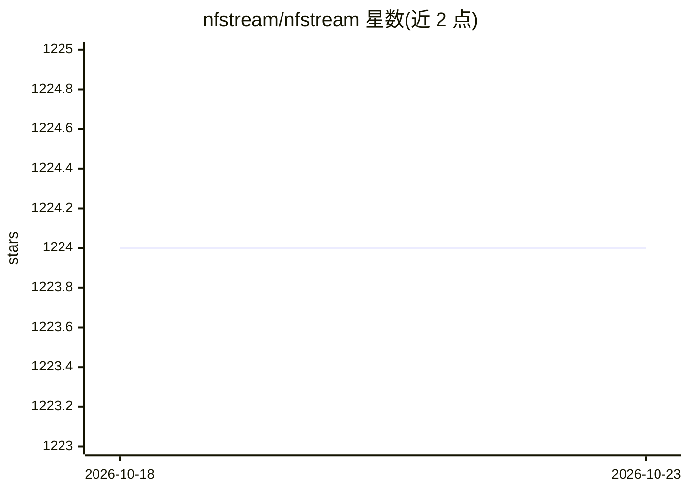

# nfstream/nfstream

⭐ 1,224 · Python · LGPL-3.0 · 推送 2026-09-14 · [GitHub](https://github.com/nfstream/nfstream) · [官网](https://www.nfstream.org) · 组织维护

**网络流量分析框架： pcap/实时流量提取流特征与数据集**

面向网络数据研究者的 Python 流量分析框架，读取 pcap 文件或实时网卡捕获，将流量聚合为带标签的网络流，基于 nDPI 做加密应用识别与元数据提取（TLS/SSH/DHCP/HTTP），提供 48 个事后统计特征与早期流（前 255 包 SPLT）特征，可探查内核获取进程级真实标签，通过 NFPlugin 用数行 Python 扩展特征并部署 ML 模型到实时流量。支持 Pandas/CSV 导出。Windows 需先安装 Npcap 驱动。

## 筛选速览

| 维度 | 判定 | 备注 |
|---|---|---|
| AI 角色 | `ai-ecosystem` | LLM/agent 周边工具 |
| 许可风险 | `viral` | LGPL-3.0 |
| 部署形态 | `library` | 以包/库形式分发 |
| 模型依赖 | — | README 未给出锁定关系 |
| 硬件要求 | — | 无带数字的原话,不猜 |
| 安装摩擦 | `low` | 无编译、无系统依赖或容器化 |
| 成熟度 | — | 结构信号不足 |

## 能力要点

- 基于 nDPI 的加密应用识别与元数据指纹提取
- 48 个事后统计特征 + 前 255 包早期流特征（SPLT）
- NFPlugin 机制：数行 Python 添加自定义特征并部署 ML 模型
- 原生 Pandas/CSV 导出接口

## 适用场景

- 把 pcap 文件聚合为带标签的网络流数据集
- 训练并在线部署流量分类 ML 模型
- 识别加密流量的应用类型并提取元数据
- 实验间复现统一的特征计算逻辑

## 场景标签

`网络安全` · 领域:学习与行业

## 证据(README 行号)

> L88: * **Machine Learning oriented:** NFStream aims to make Machine Learning Approaches for network traffic management
> L89: reproducible and deployable. By using NFStream as a common framework, researchers ensure that models are trained us
> L258: **NFStream** is intended for network data research and forensics. Researchers and network data scientists can use 

## 星数曲线

2026-10-18 1,224 → 2026-10-23 1,224（+0）

---
*卡片 v1 · prompt 1.4 · 生成 2026-10-21 · 置信度 high · 依据 README sha `3af264c5c881` · [字段定义](../../DATASET.md)*
