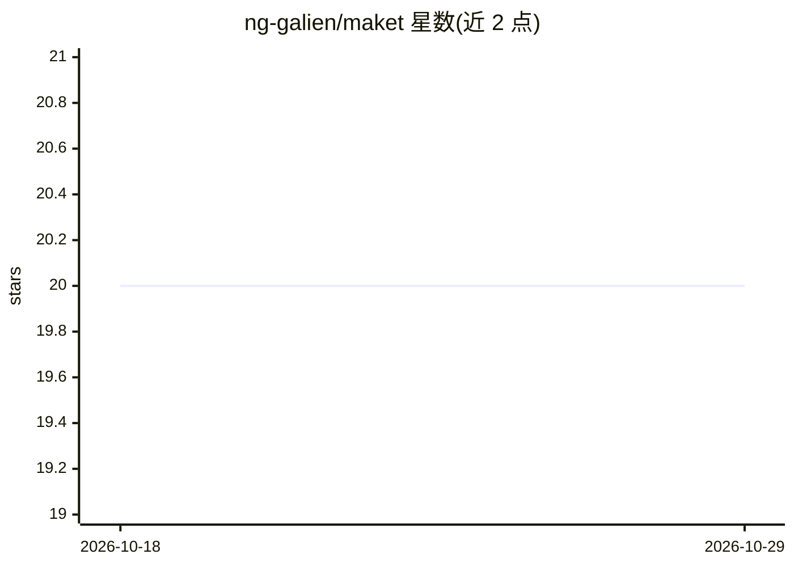

# ng-galien/maket

⭐ 20 · TypeScript · MIT · 推送 2026-10-24 · [GitHub](https://github.com/ng-galien/maket) · [官网](https://ng-galien.github.io/maket/) · 个人维护 · 中文 README

**给 AI 助手用的可视化设计工作台：HTML/CSS 画布生成海报/传单并导出 PDF**

面向 Claude、Codex、Gemini 等 MCP 客户端的视觉文档工作台：为 AI 助手提供以 mm 尺寸计的 HTML/CSS 画布与实时预览，支持品牌设计令牌（charte）约束、图片库、基于 JSON Schema 的数据驱动集合（每行渲染一个变体）以及带版本化状态的 living documents。布局经校验后通过 headless Chromium 导出印刷级 PDF，或将邮件文档转为 Gmail 草稿。随附三个 agent 技能（maket/maket-charte/maket-review）教 AI 设计、品牌化与审阅文档。提供各平台桌面安装包，也可经 npm 部署 headless 服务器。

## 筛选速览

| 维度 | 判定 | 备注 |
|---|---|---|
| AI 角色 | `ai-ecosystem` | LLM/agent 周边工具 |
| 许可风险 | `permissive` | MIT |
| 部署形态 | `desktop` | 安装包/桌面程序 |
| 模型依赖 | — | README 未给出锁定关系 |
| 硬件要求 | — | 无带数字的原话,不猜 |
| 安装摩擦 | `low` | 无编译、无系统依赖或容器化 |
| 成熟度 | — | 结构信号不足 |

## 能力要点

- HTML/CSS 画布 + 浏览器实时预览，AI 写入即呈现，支持元素级批注反馈
- 数据驱动集合：JSON Schema 类型化行 + {{占位符}} 模板，逐行批量渲染
- living documents：文档自有 JSON Schema 状态、原生控件绑定、不可变修订历史
- Print-ready PDF 导出（headless Chromium）与 Gmail 草稿交接

## 适用场景

- 让 AI 助手按品牌规范生成海报、传单、标签和社交帖
- 用模板绑定数据行批量生成产品标签、活动胸牌、证书等系列文档
- 把设计好的邮件文档导出为 Gmail 草稿由我审阅发送

## 场景标签

 · 领域:设计工具/AI Agent 基础设施

## 证据(README 行号)

> L3: **Create visual documents with your AI assistant.** Maket gives Claude, Codex, Gemini, and other MCP clients an HTML
> L10: ng-galien/maket MCP server

## 星数曲线

2026-10-18 20 → 2026-10-29 20（+0）

---
*卡片 v1 · prompt 1.4 · 生成 2026-10-28 · 置信度 high · 依据 README sha `538062b649a4` · [字段定义](../../DATASET.md)*
