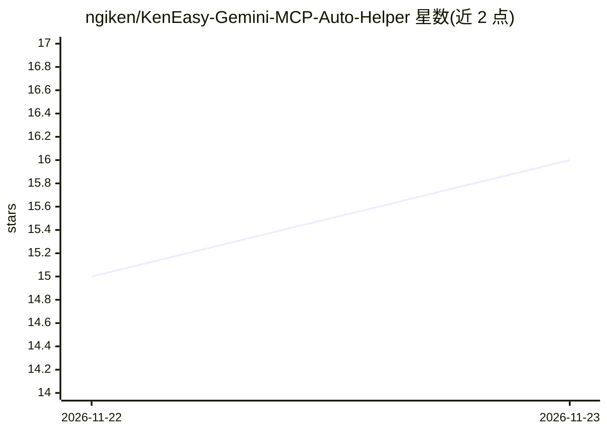

# ngiken/KenEasy-Gemini-MCP-Auto-Helper

⭐ 16 · JavaScript · MIT · 推送 2026-11-22 · [GitHub](https://github.com/ngiken/KenEasy-Gemini-MCP-Auto-Helper) · [官网](https://github.com/ngiken/KenEasy-Gemini-MCP-Auto-Helper/releases/latest) · 个人维护 · 中文 README

**为 Gemini 网页版自动放行 MCP 权限并连续点击的浏览器扩展**

面向 Chrome/Edge 的 Manifest V3 扩展，服务于在 gemini.google.com 使用 MCP 工具的用户：自动点击「始终允许/Allow once」权限弹窗与「Yes/Continue」跟进按钮，配合长按拖拽悬浮 HUD、执行卡顿时长超阈值的桌面通知（默认 5 分钟）、后台保活与标签页防休眠。内置多层熔断机制防止自动化循环：按任务/按日上限、流式输出稳定检测、操作冷却、额度报错即停、完成语识别与停滞指纹检测。支持 4 种界面语言与深浅主题，当前为 v0.2 公测版，通过 zip 包以开发者模式加载安装。

## 筛选速览

| 维度 | 判定 | 备注 |
|---|---|---|
| AI 角色 | `ai-ecosystem` | LLM/agent 周边工具 |
| 许可风险 | `permissive` | MIT |
| 部署形态 | `desktop` | 安装包/桌面程序 |
| 模型依赖 | — | README 未给出锁定关系 |
| 硬件要求 | — | 无带数字的原话,不猜 |
| 安装摩擦 | `low` | 无编译、无系统依赖或容器化 |
| 成熟度 | `idea` | |

## 能力要点

- 自动点击 Always allow 权限弹窗与 Yes/Continue 跟进按钮，含排除黑名单防误点
- 6 层防循环熔断：额度报错切断、任务/每日上限、冷却、停滞输出指纹
- 长按拖拽悬浮 HUD、桌面卡顿通知、后台保活与标签页防丢弃
- 支持简体/繁體/英/日 4 语言与深浅双主题

## 适用场景

- 在 Gemini 网页版使用 MCP 工具时免去逐次手动确认权限
- 长时间自动化任务挂后台时通过桌面通知感知卡顿
- 限制自动点击次数与额度消耗，防止循环失控

## 场景标签

`浏览器自动化` · 领域:效率与自动化

## 证据(README 行号)

> L5:  An intelligent automation extension tailored for Google Gemini web UI: auto-approves MCP tool permissions with "Alw
> L71: |**MCP Auto-Approval**|Always Allow Priority|Prefers and auto-clicks `Always allow / 始终允许`, penetrating Material We

## 星数曲线

2026-11-22 15 → 2026-11-23 16（+1）

---
*卡片 v1 · prompt 1.4 · 生成 2026-11-22 · 置信度 mid · 依据 README sha `a87371d0f53a` · [字段定义](../../DATASET.md)*
