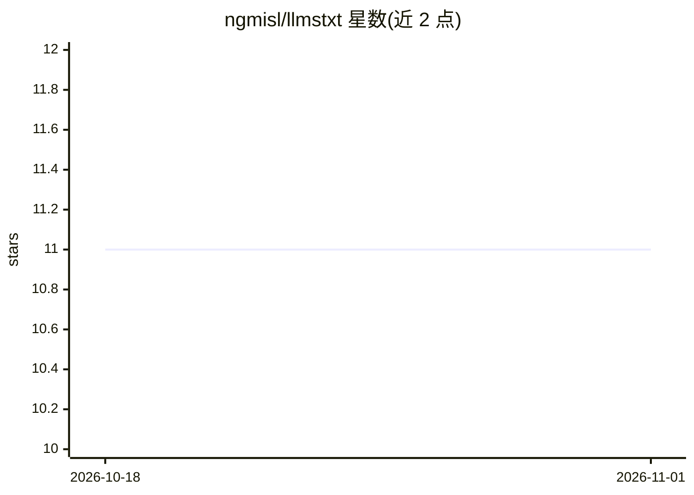

# ngmisl/llmstxt

⭐ 11 · Python · MIT · 推送 2026-10-11 · [GitHub](https://github.com/ngmisl/llmstxt) · 个人维护

**把代码库压缩成单个 LLM 友好文本文件的 Python 工具**

面向需要让 LLM 分析代码库的开发者：递归扫描当前目录（遵循 .gitignore 规则），将多语言代码文件压缩并组织为单个 llms.txt 文件，去除冗余空白与格式的同时保留 docstring、重要注释与代码结构。Python 支持 AST 级压缩，另覆盖 JavaScript、Java、C/C++、Shell、HTML/CSS、配置文件与 Markdown。输出带 XML 风格语义标记、文件元数据与清晰文件边界。提供 GitHub Actions 集成，可在 push/PR 或手动触发时自动生成并提交 llms.txt，也可通过 API 对远端仓库触发。可配置输出文件名与最大文件尺寸（默认 100KB）等参数。

## 筛选速览

| 维度 | 判定 | 备注 |
|---|---|---|
| AI 角色 | `ai-ecosystem` | LLM/agent 周边工具 |
| 许可风险 | `permissive` | MIT |
| 部署形态 | `library` | 以包/库形式分发 |
| 模型依赖 | — | README 未给出锁定关系 |
| 硬件要求 | — | 无带数字的原话,不猜 |
| 安装摩擦 | `low` | 无编译、无系统依赖或容器化 |
| 成熟度 | — | 结构信号不足 |

## 能力要点

- 多语言代码压缩，Python 走 AST 级处理，保留 docstring 与重要注释
- 输出含 XML 风格语义标记、文件元数据与导入整理的 llms.txt
- GitHub Actions 集成：push/PR/手动触发自动生成并提交
- 支持通过 GitHub API 对远端仓库触发生成

## 适用场景

- 为 LLM 分析准备压缩后的代码库文本
- 在仓库中自动维护 llms.txt 供 AI 工具读取
- 批量整理多语言项目文件为单一结构化文本

## 场景标签

`文档解析` · 领域:知识与检索

## 证据(README 行号)

> L6: A Python tool for compressing and organizing code files into a single, LLM-friendly text file. This tool is designed
> L38: - GitHub Actions integration

## 星数曲线

2026-10-18 11 → 2026-11-01 11（+0）

---
*卡片 v1 · prompt 1.4 · 生成 2026-11-01 · 置信度 high · 依据 README sha `58d661be4110` · [字段定义](../../DATASET.md)*
